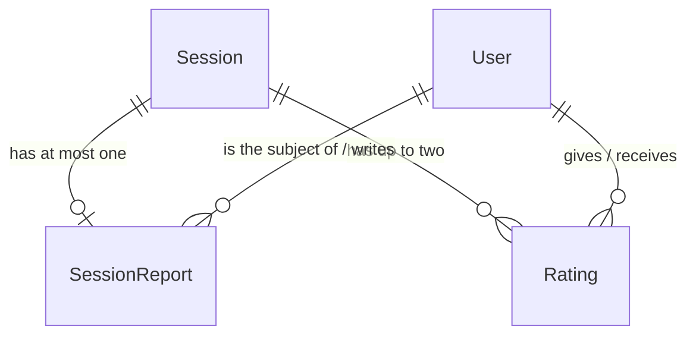

# assessment — architecture

What happened in a lesson, and how each side rated it: a teacher's report on a lesson, and
the stars one party gives the other. Today that is two tables, a typed report schema, a
Python service interface and the personal-data hooks. There is **no HTTP route and no
screen yet**: asm-report-api, asm-ratings, asm-admin-oversight and the UI units add them.

Spec: `docs/superpowers/specs/2026-10-18-asm-module-foundation-design.md` · ADR-0051
(the edge to scheduling) · ADR-0048 (export and erase hooks) · Status: built, awaiting landing
by asm-module-foundation; no progress snapshot (`asm-d-progress-scope`, deferred).

## Data model

- **SessionReport** — `session` (string FK to `scheduling.Session`, CASCADE, unique: one
  per lesson), `student` (copied from the lesson when written, so reads by student never
  join scheduling), `author` (nullable, SET_NULL: empty after the author's erasure),
  `content` (JSON), `created_at`, `updated_at`. Index `(student, created_at)`.
- **Rating** — `session` (string FK, CASCADE), `rater`, `ratee` (copied from the lesson),
  `direction` (`student_to_teacher` or `teacher_to_student`), `stars` (database
  `CHECK` 1 to 5), `comment` (up to 1,000 characters, blank allowed), `hidden`
  (`db_default=False`), `created_at`. Unique `(session, rater)`; index
  `(ratee, direction, hidden)`.

Every foreign key has `related_name="+"`: there is no reverse accessor from a lesson or a
user into these rows. The lesson relation is a string reference, so nothing imports
`scheduling.models`; services use `session_id` and never walk `report.session` (ADR-0051).

## The report content

`SessionReport.content` is JSON, but nothing writes it free-form. Every write goes through
`kaleem/assessment/content.py` (Pydantic v2, strict, `extra="forbid"`, strings stripped)
and is stored without absent optional keys.

| Key | Rule |
| --- | --- |
| `schema_version` | required, the integer `1` |
| `covered` | required, 1 to 2,000 characters |
| `next_plan`, `homework` | optional, up to 2,000 characters; a blank is stored as absent |
| `passage` | optional `{surah, from_ayah, to_ayah}`: surah 1 to 114, `1 <= from_ayah <= to_ayah <= the surah's ayah count` |
| `focus` | optional slug: `memorization`, `revision`, `recitation`, `tajweed`, `tafsir`, `arabic`, `other` |

**Versioning.** The reader dispatches on `schema_version`. A later version adds a model and
an up-converter from the older ones; stored rows are never rewritten by a read. A version
this module does not know raises `platform.ValidationError`. Validation errors name the
field and the rule and never the submitted value, so a child's free text cannot reach a log
line through a failure.

**Quran reference data** (`quran.py`). A passage is a surah number and an ayah range, no
text (`dec-quran-reference-source`). The only data is 114 integers, the ayah count of each
surah in the Kufan count used by the Hafs mushaf (they sum to 6,236), taken from Tanzil's
published metadata. Counts carry no text licence. Focus labels and their Arabic wording
belong to the teacher-report UI, not here.

## Public API

Everything outside the module goes through `kaleem.assessment.services`, which returns
frozen dataclasses (`ReportInfo`, `RatingSummary`), never models. Lesson facts come from
`scheduling.services.get_session`; the student's parents from
`identity.services.is_parent_of`; "is their current teacher" from
`scheduling.services.active_assignments`.

| Service | Does |
| --- | --- |
| `parse_report_content(data)` | Validates content of a known version; `ValidationError` otherwise |
| `save_report(author, session_id, content)` | Creates or replaces the lesson's report |
| `get_report(session_id)` | The report or `None`; the caller authorizes |
| `can_read_report(user, session_id)` | The audience rule below |
| `reports_for_student(viewer, student_id, *, before, limit)` | Keyset page, newest first, filtered by the same rule |
| `record_rating(rater, session_id, stars, comment="")` | A party rates the other; a repeat replaces |
| `teacher_rating_summary(teacher_id)` | Visible student ratings: count and mean (one decimal), or `None` |
| `reported_session_ids(session_ids)` | Which lessons have a report |
| `purge_expired(*, now=None)` | The retention job; returns the rows changed; idempotent |

**Writes.** `save_report` refuses, in this order: an unknown lesson (`NotFoundError`),
anyone but the lesson's teacher (`PermissionDeniedError`), a cancelled lesson or one not yet
started (`ConflictError`), then invalid content (`ValidationError`). Permission comes before
state so an outsider learns nothing about a lesson. `record_rating` derives direction and
ratee from which party the rater is; a parent or a non-party is refused. The outcome and
7-day window rules of `dec-lesson-outcomes` are added to `save_report` by asm-report-api,
once ana-session-outcomes has shipped the outcome.

**Who may read a report** (`asm-d-report-audience`):

- the lesson's teacher (the writer), the student, the student's parents, and staff, always;
- the student's **current** teacher in the **same subject**, for a report no more than
  90 days old ("3 months", read as 90 days, measured from the report's `created_at`).
  A former teacher, a current teacher of another subject or of another student, and
  everyone else are refused. An unknown lesson and an anonymous user read nothing.

`reports_for_student` applies the same rule per report and returns an empty list, never an
error, to a viewer who may read none. The cursor is the last returned report's `id`.

**Who sees a rating** (`asm-d-rating-visibility`, `dec-student-rating-visibility`): a
teacher sees an average and a count only, and only once **three or more distinct students**
have rated them; comments and individual rows are staff-only; hidden ratings leave every
average; teacher-to-student ratings never count towards a teacher's average. Ratings of a
student are staff-only. This unit enforces the summary rule; the endpoints that expose
these arrive with asm-ratings.

## Retention

Reports live as long as their lesson (they cascade with it). Ratings, 12 months (read as
365 days) after `created_at` (`asm-d-retention`): every comment is blanked, and
teacher-to-student ratings are deleted. Student-to-teacher stars live as long as the lesson.
`purge_expired` does this in one transaction and a second run changes nothing.

The Celery task `kaleem.assessment.tasks.purge_expired_ratings` ships **without a beat
entry**. The blue-green rule deploys a task name one release before anything enqueues it,
and nothing writes a rating until asm-ratings, which adds the `CELERY_BEAT_SCHEDULE` entry.

## Personal data (ADR-0023, ADR-0048)

- **What:** what a teacher wrote about a child's lesson (free text, a passage, a focus tag),
  and stars with an optional comment each way. Children's data.
- **Why:** lesson continuity for the teacher, visibility for the family, quality oversight
  for staff. No ranking or matching input in v1.
- **How long:** above.
- **Who sees:** above.

One hook pair, `assessment.records`, registered from `AssessmentConfig.ready()`
(`personal_data.py`) and covering both models.

- **Export:** reports about the user, reports the user wrote, ratings the user gave (with
  their own comment), and ratings the user received as direction, stars and date only: no
  rater, no comment, no lesson id.
- **Erase** (order 500): delete reports about the user; set `author` to NULL on reports the
  user wrote; delete ratings the user gave or received (lb-dec-erasure-semantics:
  anonymize in place, so a teacher's erasure leaves the family's reports standing).

`tests/test_personal_data_hooks_cover_every_model.py` has no pending entry for
`assessment`: both models are covered from day one.

## Boundaries

`assessment` may import `kaleem.platform` and call `identity.services` and
`scheduling.services`. Three contracts in `backend/pyproject.toml` hold it (ADR-0051): the
"except identity and scheduling" forbidden contract with three named transitive edges
ignored, and a mirror for each of `identity.models` and `scheduling.models`. Tests are
exempted from the two mirrors because they build users and lessons directly. No new events.

## Not here yet

Any endpoint, serializer or screen; the outcome and window rule for writing; hiding a
rating and staff correction of a report (asm-admin-oversight); parent ratings
(`asm-d-parent-rating`, asm-ratings); a progress snapshot; seed accounts and lesson states
(asm-e2e-fixtures). There is no e2e flow for this unit because it has no user-facing
behaviour.
