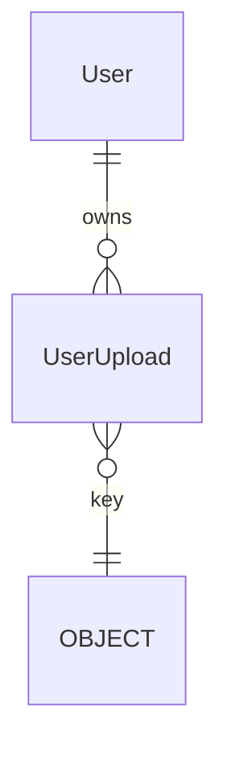

# content — architecture

Durable, private storage for the files people upload, the checks every upload passes, and a
small Python API to use it. Today that is one table, four service functions, one storage
alias, the upload policy, the personal-data hooks and one operator command. There is **no HTTP route and no screen**: each consumer
(`cur-profile-photo`, `cur-resources-library`, `msg-attachments`) adds its own endpoint and
its own access check.

Spec: `docs/superpowers/specs/2026-10-25-cur-content-storage-design.md` and
`docs/superpowers/specs/2026-11-22-cur-upload-safety-design.md` (the upload checks) ·
ADR-0062 (storage and file serving) · ADR-0049 (the edges to curriculum) · ADR-0048 (export and erase hooks).

## Data model

- **UserUpload** — `owner` (FK to the user model, `PROTECT`, `related_name="+"`), `kind`
  (an `UploadKind` value, plain text), `key` (unique, `u/<uuid4 hex>`), `original_name`,
  `content_type`, `size`, `created_at`. The FK is `PROTECT` so a row, and its object, goes
  only through `delete_upload` or the erase hook, never as a silent cascade.

`key` is a `CharField`, not a `FileField`: a `FileField` resolves its storage once at
import, so tests could not move it onto a temporary directory and production could not tell
"configured" from "not configured" at call time. Kinds are a code enum, so adding one needs
no migration.

## Public API (`kaleem/content/services.py`)

| Call | What it does |
| --- | --- |
| `upload_user_file(owner, kind, file, original_name)` | Checks the file (below), then writes the object and the row. Removes the object if the insert fails. `ValueError` for an unknown kind, `UploadRefused` for a file that fails a check. There is no `content_type` parameter: the type is read from the bytes. |
| `get_upload(id)` | `UploadInfo` (a frozen dataclass; never the model). |
| `download_url(id)` | A signed URL, 300 seconds, `attachment` disposition, the stored type. |
| `delete_upload(id)` | Deletes the row now and the object once the transaction commits. |

`UploadThrottle` is also exported from `content.services`; see "The throttle" below.

An unknown id raises `NotFoundError("File", id)` (code `not_found`, with an Arabic catalog
entry). Deleting an already-deleted id is the same not-found.

**The access rule.** `content` never decides who may read a file. `download_url`,
`get_upload` and `delete_upload` trust their caller, and every consumer checks access
(chat membership, the teaching link, ownership) first. Its own spec states the check.
`content` imports only `kaleem.platform` and calls `identity.services` if it must; it
imports no business module's models, and its two import contracts are unchanged.

## The upload policy

`upload_user_file` is the only way into the store (ADR-0062), so the checks live there and no
consumer can skip them or get them wrong. They are constants in `kaleem/content/policy.py`;
changing one is a one-line PR. The type is **sniffed from the file's own bytes**
(`sniff.py`, the first 4 KiB, no `libmagic`): the name and the declared type are never used.

| Family | Accepted when the bytes are | Stored as | Size cap (as received) |
| --- | --- | --- | --- |
| image | JPEG, PNG or WebP, one frame, at most 30 megapixels | the same format, re-encoded | 10 MB |
| pdf | `%PDF-` at offset 0 | `application/pdf`, byte for byte | 20 MB |
| audio | MP3 (an ID3 tag or a Layer III frame header), or M4A (an `ftyp` box with `M4A ` as a major or compatible brand) | `audio/mpeg`, `audio/mp4`, byte for byte | 30 MB |

| Kind | Families |
| --- | --- |
| `profile_photo` | image |
| `resource` | pdf, image, audio |
| `message_attachment` | image, pdf |

Megabytes here are 1024 x 1024 bytes. Anything else is refused, including GIF, HEIC, SVG,
animated PNG and WebP, and every video format (video is shared as a link). A kind that is
added to `UploadKind` without a row in the policy fails `test_policy.py`.

The order inside `upload_user_file`: kind, then `require_storage()` (before the file is read
and before any query), sniff and the kind's families, the cap on the received bytes, the image
re-encode, the owner's quota, the name, then the object and the row. Nothing is written for a
refusal.

- **Image re-encode** (`images.py`). The size in pixels is read from the header and checked
  before any pixel is decoded, so a small file that declares a huge canvas is refused cheaply.
  The image is then decoded, the EXIF orientation is applied, and a new file is written with
  nothing but pixels (and transparency): EXIF, GPS, text chunks, colour profiles and print
  resolution are not carried over. CMYK becomes RGB. Pillow's own global pixel limit is left
  alone.
- **Quota.** 1 GiB stored per owner across all kinds, counted on the stored size (after a
  re-encode). Exactly reaching it is allowed.
- **Name** (`naming.py`). Only the last path segment, with control and direction-override
  characters removed, cut to 255 characters, and ending in the sniffed type's canonical
  extension (`.jpg .png .webp .pdf .mp3 .m4a`), so a PDF cannot be saved as `x.html`.
  `content_type` on the row is always the sniffed type, and `size` the bytes stored.
- **Refusals.** `UploadRefused` (in `content.errors`, exported from `content.services`) is a
  `platform` `ValidationError` without a field, so the existing handler answers 400
  `{"detail", "error_code"}`. The codes: `upload_type_not_allowed`, `upload_too_large` (a cap
  or the pixel limit), `upload_quota_exceeded`, `upload_unreadable` (an image that cannot be
  decoded). Messages follow the request's language, each with an Arabic catalog entry.
  Consumers branch on the code alone.
- **Dependency.** `pillow`, upper-bounded at the next major. Its wheel needs no system
  library, so the Dockerfile is unchanged.

### The throttle

`content.services.UploadThrottle` is a per-user throttle under the scope `upload`, 60 requests
an hour (`config/settings/base.py`; `local.py` raises it to 1000 for the e2e suite). Each
consumer's upload view lists it in `throttle_classes`, and its spec says so. It sets its own
scope, so a view cannot forget a second `throttle_scope` line and be silently unthrottled.

## The storage alias

`STORAGES["uploads"]` is read at call time. It has three shapes:

| Environment | Backend |
| --- | --- |
| local, test, CI (`base.py`) | `LocalUploadsStorage`, the filesystem under `MEDIA_ROOT`; `url()` accepts and ignores the signing parameters and returns `/media/<key>`, served only with `DEBUG` on |
| production, all four `DJANGO_UPLOADS_*` set | `S3Storage`: private bucket, `s3v4`, virtual-hosted addressing, `querystring_auth`, `querystring_expire=300`, no ACLs, `file_overwrite=True` |
| production, none set | `NotConfiguredStorage`: every operation raises `StorageNotConfigured` |

`StorageNotConfigured` lives in `kaleem.platform.exceptions` (the exception handler cannot
import `content`) and maps to **503** with `error_code` `storage_not_configured`. The
services call `require_storage()` before touching the database, so an unconfigured
deployment writes no row and deletes no row. `get_upload` and the export hook read only the
database and keep working.

Production **never** falls back to the disk, because a file written to a container's disk is
lost at the next colour flip. `ContentConfig.ready()` logs one warning per process when the
alias is `NotConfiguredStorage`; it names the variables and no value. Setting only some of
the four stops the deploy at import (`ImproperlyConfigured`).

Keys are random server-side, so the backend skips the existence check
(`file_overwrite=True`), which would otherwise need the list permission the application key
deliberately lacks.

## Bucket and IAM setup

Deferred to the setup-and-deployment step. Per environment, one bucket and one IAM user; the
exact settings (Block Public Access, bucket-owner-enforced, SSE-S3, versioning, the 30-day
lifecycle rule, the deny-insecure-transport policy, and the four-action inline IAM policy)
are in the spec's "Owner setup" section. The application key has no list and no version
actions, so a leak cannot permanently destroy stored files.

## Personal data (`content.uploads`)

- **Export** — metadata only: kind, original name, content type, size and creation time, in
  id order. No key and no URL (a URL is not deterministic; a key is internal). Delivering the
  bytes is the export unit's job.
- **Erase** — deletes the user's rows and, on commit, their objects. Registered with
  `order=900`, so a consumer whose rows point at an upload runs its erase hook first. With no
  store configured it raises instead of deleting rows it could not delete objects for (and
  does nothing for a user with no rows).
- A failed object delete is logged and skipped, never raised: the row is already gone, and a
  surviving object is an unreachable orphan that `cur-content-retention` sweeps.
- Retention: the row and object live until a consumer deletes them or the user is erased; a
  non-current version stays in the bucket for up to 30 days (`dec-cur-retention`).

## Operator command

`manage.py check_upload_storage` writes a random canary under `canary/`, reads it back,
fetches its signed URL when that is an absolute `https` URL, and deletes it. Any failure
exits non-zero and names the step (`write`, `read`, `url`, `fetch`, `delete`); with no store
it exits non-zero saying "not configured". `--keep` leaves the canary and prints its key;
`--existing <key>` checks and deletes one an earlier run kept. Run with `--keep` before a
deploy and `--existing` after the colour flip to prove a file survives.

## Not here

Any endpoint or permission check (the consumers); retention purges and the orphan sweep
(`cur-content-retention`); the offsite copy and restore drill (`cur-media-backup`); serving
through kaleem's domain or a CDN. A Content-Security-Policy `img-src` entry for the bucket
origin is owed by `cur-profile-photo` if a CSP sets `img-src` before it ships.
