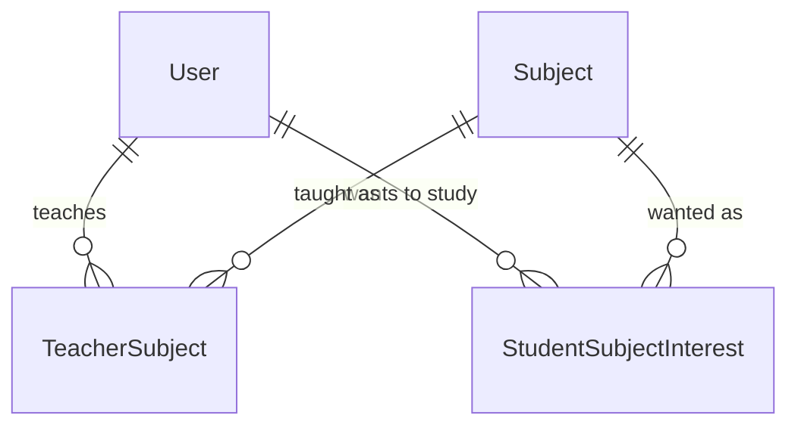
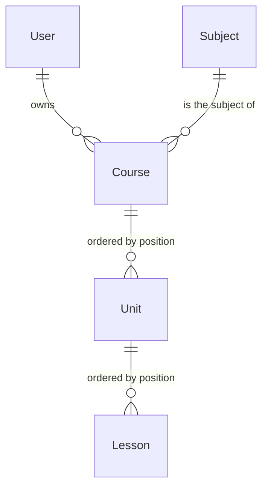

# curriculum — architecture

What kaleem teaches, and who teaches or wants to study it. Two halves: a `Subject`
catalogue with the teacher and student links to it (`curriculum` exists this early because
Phase C's matcher needs subject as an input), and the course builder, where a teacher makes
a `Course` of ordered `Unit`s and `Lesson`s.

Specs: `docs/superpowers/specs/2026-09-04-phase-c0-matching-inputs-design.md` (subjects,
ADR-0031, shipped Phase C0) · `docs/superpowers/specs/2026-10-18-cur-course-structure-design.md`
(the course builder, v1 wave 2).

## Data model

- **Subject** — `slug` (unique), `name`, `is_active`, timestamps. Admin-managed, so adding
  a fourth subject is a row rather than a migration and a deploy. Seeded with `quran`,
  `tafsir` and `arabic` by migration `0002_seed_subjects`, which uses `update_or_create` so
  it converges on a database where a row was added by hand instead of failing the deploy.
  Retiring a subject means `is_active = False`, never a delete — existing links stay
  readable.
- **TeacherSubject** — `user` → `subject`, unique together. A teacher teaches many.
- **StudentSubjectInterest** — `user` → `subject`, unique together. A student wants many.

Both links are **rows, not a JSON blob on a profile** (rule #3) and **many-over-time, not a
`OneToOneField`** (rule #7). Both key to `AUTH_USER_MODEL` **by string**, which is what lets
this module reference users without importing `identity`'s models.

### The course builder

- **Course** — `owner` → user (by string, CASCADE), `subject` → `Subject` (PROTECT:
  subjects are retired, never deleted), `title` (200), `description` (at most 2,000
  characters), timestamps. A course is **private to its owning teacher**
  (dec-cur-ownership, option 1: students keep access after a teacher change, which binds
  cur-lesson-assignment, not this table).
- **Unit** — `course` (CASCADE), `title`, `position`. **Lesson** — `unit` (CASCADE),
  `title`, `body` (plain text, at most 20,000 characters), `position`. A lesson belongs to
  one unit for good: lessons do not move between units.
- **Positions are 0-based and dense** (0..n-1) after every add, delete and reorder. Each
  `(parent, position)` pair has a `UniqueConstraint` with `deferrable=DEFERRED`, so a
  reorder can rewrite every position in one transaction without tripping over a
  half-finished swap. ⚠ pytest-django never commits, so a deferred violation passes
  silently in an ordinary test: `test_models.py` forces the check with
  `SET CONSTRAINTS ALL IMMEDIATE`, and swapping inside one transaction is its own test.
- **Limits**, enforced in the services, not the database: 50 courses per teacher, 50 units
  per course, 100 lessons per unit. A limit is reported as a 400 on the `title` field.
- **Deletes are hard deletes.** Deleting a course takes its units and lessons with it.

ADR-0023: the tables hold text a teacher writes (titles, descriptions, lesson bodies),
linked to the teacher's user id; nothing about students. Kept until the teacher deletes it
or the account is erased. Seen by the owning teacher only, through the API; not registered
in the Django admin.

## Public API

Everything outside the module goes through `kaleem.curriculum.services`. Callers never touch
the models.

| Service | Does |
| --- | --- |
| `list_active_subjects()` | Every `is_active` subject |
| `get_teacher_subjects(user_id)` | The teacher's slugs, sorted |
| `set_teacher_subjects(user_id, slugs)` | Replaces the whole set; returns what was stored |
| `get_student_subjects(user_id)` | The student's slugs, sorted |
| `set_student_subjects(user_id, slugs)` | Replaces the whole set; returns what was stored |

Course builder services take the acting teacher's id first and scope every query to it, so
a course nobody owns and a course somebody else owns are the same `NotFoundError`:

| Service | Does |
| --- | --- |
| `create_course(teacher_id, *, title, subject_slug, description="")` | New course; returns the tree |
| `list_courses(teacher_id)` | The teacher's courses, oldest first, with unit and lesson counts |
| `get_course(teacher_id, course_id)` | The tree: units and lessons in position order |
| `update_course(...)` / `delete_course(...)` | Change only the fields given / hard delete |
| `add_unit` / `rename_unit` / `delete_unit` / `reorder_units` | By course id, then unit id |
| `add_lesson` / `update_lesson` / `delete_lesson` / `reorder_lessons` | By unit id, then lesson id |

Every service except `list_courses` and `delete_course` returns the whole course tree, so
the dashboard replaces its cache in one step. A course keeps a subject that is retired
later; only changing *to* an unknown or retired subject is refused.

**Ordering and locking.** Every write runs in one transaction and takes
`select_for_update()` on the course row first (a unit or lesson id is resolved to its
course, locked, then re-read, so a concurrent delete surfaces as not-found). Concurrent
edits of one course are therefore serialized rather than interleaved. Creating a course
takes a transaction-scoped Postgres advisory lock per teacher instead, because there is no
row to lock for "the next course" and locking the user row would reach into identity's
table. A reorder must name **exactly** the current set of ids: a missing, extra,
duplicated or foreign id is a `ConflictError` (409, "reload"), never a partial write,
because it means the caller is working from a stale view.

A symmetric quartet on purpose: the dashboard hooks mirror these names exactly, so a reader
can move between the two repos without translating.

**`_resolve` runs before the delete inside `_set`.** Validation first is not incidental — the
obvious ordering (delete, then insert what resolves) wipes a user's existing subjects on its
way to rejecting a payload with one bad slug, and passes every other test. Pinned by
`test_a_rejected_payload_leaves_the_previous_set_intact`.

Unknown or inactive slugs raise `platform.exceptions.ValidationError` rather than being
dropped silently: a typo'd slug that vanished would look to the caller like a successful save
of a smaller set (rule #8).

## API surface

All under `/api/v1/curriculum/`, mounted through `config.api_router` (ADR-0029).

| Method | Path | Who |
| --- | --- | --- |
| `GET` | `subjects/` | any authenticated user |
| `GET` `PUT` | `me/teacher-subjects/` | teacher (403 otherwise) |
| `GET` `PUT` | `me/student-subjects/` | student (403 otherwise) |
| `GET` `POST` | `courses/` | teacher (403 otherwise) |
| `GET` `PATCH` `DELETE` | `courses/<id>/` | the owning teacher (404 for anyone else) |
| `POST` | `courses/<id>/units/` | the owning teacher |
| `PUT` | `courses/<id>/unit-order/` | the owning teacher |
| `PATCH` `DELETE` | `units/<id>/` | the owning teacher |
| `POST` | `units/<id>/lessons/` | the owning teacher |
| `PUT` | `units/<id>/lesson-order/` | the owning teacher |
| `PATCH` `DELETE` | `lessons/<id>/` | the owning teacher |

Every mutation except a course delete (204) answers with the whole course tree; order is
the array order and positions are not exposed. "Teacher" means a teacher *profile*, so an
account that is also a student can build. A course that is not yours and one that does not
exist return the same 404.

**Two role-explicit paths rather than one `/me/subjects/`.** A person may hold both profiles,
so a single endpoint would have to guess which set the caller meant, or reject the ambiguity
with a 400 that has no correct follow-up. Two paths make the dual-role case ordinary.

There is no shared base class behind the two views. An earlier draft had one; its entire
content was stubs that existed to be overridden, and covering them meant a test reaching into
private members. Two explicit views duplicate three lines per verb and name the table they
touch.

## Personal-data registry and e2e seed

`kaleem/curriculum/personal_data.py` registers one hook pair, `curriculum.courses`
(ADR-0048), from `CurriculumConfig.ready()`. Export is the teacher's course trees in the
order they built them, with ISO dates; erase deletes the teacher's courses. The three older
models are not covered, so curriculum stays in the coverage guard's `PENDING_EXPORT` and
`PENDING_ERASE` (lb-gdpr-data-export / lb-gdpr-erasure remove the entries).
cur-lesson-assignment must revisit the erase hook once students hold lessons.

`seed_e2e_curriculum` (listed in `config/e2e_seeds.txt` after `seed_e2e_matching`) deletes
`e2e.teacher@kaleem.test`'s courses and rebuilds "E2E Course" through the services: Unit 1
with Lesson A, B and C, and an empty Unit 2. It adds no `TeacherSubject` row, so matching
state is unaffected, and it refuses `DEBUG=False`.

## Boundaries

`curriculum` depends on `identity` and `content`, each only through its `services` module
plus the `AUTH_USER_MODEL` string. Three import-linter contracts hold it there:

- `curriculum imports no business modules except identity and content`
- `curriculum does not reach past identity's public API` — `allow_indirect_imports`, so the
  legitimate `curriculum.services → identity.services → identity.models` chain stays legal
  while a direct model import fails.
- `curriculum does not reach past content's public API` — the same shape for
  `kaleem.content.models`.

The `content` edge is allowed by ADR-0049 and nothing uses it yet; cur-lesson-resources
creates it. Scheduling's contract ignores that one import (`curriculum → content.services`)
so the transitive rule does not turn it red.

**`curriculum` never imports `scheduling`** (`scheduling → curriculum` exists, ADR-0033, and
the reverse would be a cycle). "Does this teacher teach this student?" is answered by the
platform port `kaleem.platform.teaching` (`teaches`, `student_ids_taught_by`), which
scheduling fills from its `ready()`. Both raise `ImproperlyConfigured` when nothing is
registered rather than answering False. Nothing in curriculum calls it yet.

The identity mirror was written **before** any code and verified by breaking it. That is the
lesson from `scheduling`, which shipped without the mirror and where a direct
`from kaleem.identity.models import User` passed CI until 2026-09-04.

Note the arrow's direction is load-bearing in the other direction too: **`identity` may not
import `curriculum` at all.** This is why `seed_e2e`, which lives in `identity`, cannot reset
a teacher's subjects — the e2e specs converge their own fixture instead.

## Deliberately not here

- **Matching.** No `TeacherAssignment`, no ranking. Phase C1.
- **Booking, sessions, quota, video.** Phases C2 and C3.
- **Assigning lessons, the student and parent views, completion, lesson resources,**
  moving a lesson to another unit, and sharing, duplicating or publishing a course.
  Later units (cur-lesson-assignment, cur-lesson-completion, cur-lesson-resources) build on
  these tables.
- **Subject proficiency or level** (beginner vs advanced Arabic). A matching refinement; C1
  adds it if the ranking needs it.

## Personal-data export

`curriculum.subjects` (`personal_data.py`, registered from `CurriculumConfig.ready()`)
exports the subjects a person teaches and the subjects they want to study, as
`{subject (slug), since}`. `Subject` itself is a `NOT_PERSONAL` catalogue row. The erase hook
is lb-gdpr-erasure.
