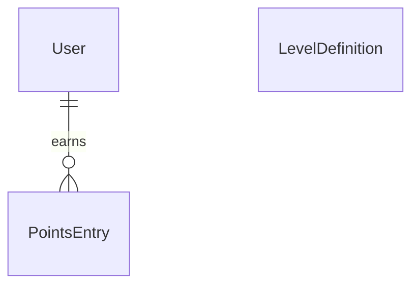

# engagement — architecture

Points for the lessons a student actually had, and a level computed from them. Today that
is two tables, one bus subscriber, one read endpoint and the personal-data hooks. Streaks,
badges, leaderboards and the dashboard card are later units (`eng-streaks`, `eng-badges`,
`eng-leaderboards`, `eng-dashboard-ui`) and build on this.

Spec: `docs/superpowers/specs/2026-11-22-eng-points-levels-design.md` · ADR-0063 (the event
bus) · ADR-0048 (export and erase hooks).

## Data model



- **PointsEntry** — `student` (FK to the user model, `CASCADE`), `reason` (`lesson_delivered`
  today), `source_id` (the lesson's id, a plain integer), `amount` (`CHECK > 0`),
  `occurred_at` (the event's), `created_at`. **Unique on `(reason, source_id)`**: one lesson
  earns once, however many times its event arrives.
- **LevelDefinition** — `number` and `min_points`, both unique. Reference data.

**The ledger is append-only.** No code path updates or deletes a line except the erase hook.
A total is always `SUM(amount)` at read time: there is no cached counter, so nothing races
and nothing drifts. `source_id` is not a foreign key because engagement may not import
scheduling and the line must outlive the session row (seeds delete sessions).

**Levels are reference data in a migration.** `0002_seed_levels` seeds ten levels, numbered
and never named, at 0 / 50 / 150 / 300 / 500 / 750 / 1050 / 1400 / 1800 / 2250 points
(5 to 225 delivered lessons at 10 points each). The level is the highest `number` whose
`min_points` is at most the total; level 10 is the top and points keep counting past it.
Changing a threshold is a data migration. There is no staff screen.

## Public API (`kaleem/engagement/services.py`)

| Call | What it does |
| --- | --- |
| `get_user_state(user_id)` | `PointsState` (a frozen dataclass): `points`, `level`, `next_level`. `level` is `None` only on an empty level table; `next_level` is `None` at the top. |

`award_points` stays internal (`engagement/points.py`). It becomes public when
`eng-more-sources` needs it, under that unit's spec.

## The subscriber (`kaleem/engagement/handlers.py`)

`EngagementConfig.ready()` calls
`events.subscribe("scheduling.session_completed", "engagement.points_lesson_delivered", fn)`.
The handler reads the payload as a plain mapping, so engagement never imports scheduling.

| Event | Result |
| --- | --- |
| `outcome == "held"` | 10 points (`POINTS_PER_DELIVERED_LESSON`) to the student |
| `outcome == "student_absent"` | nothing |
| any version other than 1 | nothing (the bus contract: ignore versions you do not know) |
| the student's user row is gone | a warning is logged, nothing is recorded, no raise |
| `scheduling.session_cancelled` | not subscribed to: no cancellation earns anything |

It runs inside the bus's own transaction, so a raise rolls back the ledger line and its
`HandledEvent` pair together and the bus retries; the close-out is unaffected because it had
already committed. A taken-back lesson (a later `teacher_absent` ruling) does **not** remove
points: the student attended.

Lessons delivered before this shipped are credited once, by running
`replay_events --handler engagement.points_lesson_delivered` after the first deploy. The
event log only reaches back 90 days and starts 2026-11-08; the replay is idempotent.

## API

`GET /api/v1/engagement/me/`, session auth, read only:

```json
{ "points": 30,
  "level": { "number": 1, "min_points": 0 },
  "next_level": { "number": 2, "min_points": 50 } }
```

A caller with no student profile gets 403 `permission_denied` (message translated, with an
Arabic catalog entry). There is no way to name another user. Who may see a student's points:
the student today; a linked parent in `eng-dashboard-ui`; teachers never; everyone else only
after `eng-leaderboards` is decided.

## Personal data

One hook pair, `engagement.points`, over `engagement.PointsEntry`.

- **Export:** the total, the level number and each line as `{reason, amount, occurred_at}`.
  No ids.
- **Erase:** deletes the person's lines. Idempotent.
- **Retention:** the account's lifetime (`dec-retention-new-domains`). There is no time-based
  purge; the erase hook is the purge.

`engagement.LevelDefinition` is in `NOT_PERSONAL` (a catalogue row linked to no person). The
event log's own hooks erase every event naming the person, so a `replay_events` after an
erasure cannot re-award points to an anonymized user.

## Boundaries

Engagement imports `kaleem.platform` and `kaleem.identity.services` only; no import contract
changed. Its tests may not import scheduling or identity's models either: they publish
through `events.registry.type_named(...).cls` and build users through `identity.services`.
The real close-out-to-points path is wired and tested once, in
`backend/tests/test_engagement_points_wiring.py`.
