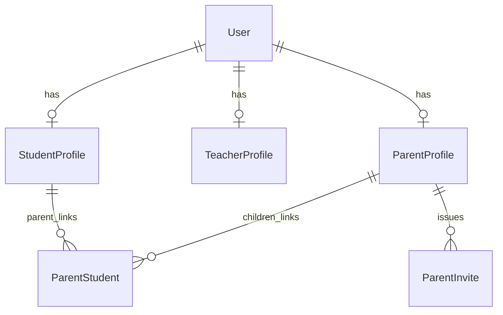

# identity — architecture

The foundational module: one `User` plus optional profile tables, email-based auth via
django-allauth, and the parent↔child relationship. Every other module depends on it.

Spec: `docs/superpowers/specs/2026-06-08-identity-module.md` · Status: shipped (Phase A).

## Data model

- **User** — single identity. Email is the username (`USERNAME_FIELD = "email"`), no
  `username` field. Roles are *not* on the user; they are expressed by which profile
  tables exist. `is_staff=True` ⇒ admin. A user may hold multiple profiles. `language`
  (`""` = never chosen, else a `settings.LANGUAGES` code; `db_default` so the previous
  release's inserts still work) and `timezone` (IANA name, default `UTC`) are the
  recipient's locale: work done with no request in hand (mail, reminders) reads them.
  `erased_at` (nullable, no default) is set once when the account is erased; see Account
  deletion below.
- **StudentProfile / TeacherProfile / ParentProfile** — `OneToOne` to User. Carry
  role-specific data (student: time + teacher-gender preferences; teacher: availability,
  `is_in_pool`; parent: none yet, a marker).
- **ParentStudent** — many-over-time link, one parent → many children (`unique_together`).
  Deliberately a FK link table, not a `OneToOne`.
- **ParentInvite** — a 24h code (`INVITE_TTL`) a parent gives an existing student so the
  student self-links. Issuing a new invite expires any prior unused one.

## Public API (`identity/services.py`)

All inter-module calls enter here — no other module may import identity's models
(enforced by import-linter, contract in `pyproject.toml`).

| Function | Purpose |
| --- | --- |
| `register_user(full_name, email, password, account_type, birthdate=None, language="", timezone="UTC")` | Adult student/parent + initial profile; seeds the locale (the register view passes the request language reduced to its primary subtag, and the browser's zone) |
| `create_child(parent_user_id, full_name, email, password=None, preferences=None)` | Child User with a **real parent-provided email** + StudentProfile + link; sends an activation email (verification link if a password was set, else a set-password link that also verifies) |
| `set_child_password(parent_user_id, student_profile_id, password)` | Parent sets a child's login password |
| `set_child_email(...)` / `set_child_preferences(...)` / `resend_child_verification(...)` | Parent manages a child's email (migrates legacy placeholder children + re-sends activation), preferences, or re-sends a pending activation |
| `create_invite(parent_user_id)` / `accept_invite(student_user_id, code)` | Parent↔child self-linking |
| `set_student_profile(...)` | Onboarding preferences |
| `create_teacher_account(email, full_name)` | Admin-driven; unusable password + password-set email, email pre-verified |
| `add_email_address(user_id, email, current_password)` | Add a new **unverified** address (password re-auth, uniqueness + cap checks); alerts current primary |
| `set_primary_email(user_id, email_id, current_password)` | Promote a **verified** address to primary (swaps `User.email`); alerts previous primary |
| `remove_email_address(user_id, email_id)` / `list_email_addresses(user_id)` | Remove a non-primary address / list addresses |
| `export_account_data(user_id, current_password)` | The person's own data export: password re-check, then the personal-data registry's `export_user` inside a versioned envelope; alerts the primary address |
| `delete_account(user_id, current_password)` | The person's own account deletion: staff refused, password re-check, then the personal-data registry's `erase_user` (anonymize in place); the `account_deleted` alert is queued after commit. A hook's refusal (a live subscription) propagates unchanged |
| `set_language(user, code)` / `set_timezone(user, tz)` | Save the account's language (`en`/`ar`; blank refused) or IANA zone; unsupported values raise `ValidationError` on the `language` / `timezone` field |
| `get_recipient_locale(user_id)` / `get_recipient_locales(user_ids)` | The `(language, timezone)` `RecipientLocale` to use for work done on a person's behalf. A blank language resolves to `en`, so callers always get a supported code. The bulk read is one query and skips unknown ids; the singular raises `NotFoundError` |
| `get_profile_types`, `get_children`, `is_parent_of`, `get_*_profile`, `get_user` | Reads |

Errors are typed (`platform.exceptions.ValidationError` / `NotFoundError`) — never bare
`Exception`. Write operations are `@transaction.atomic`.

## Auth & HTTP (`identity/api/`)

- Session cookies + real CSRF, same-origin. No JWT. allauth handles email verification
  (mandatory) and password reset; landing pages live under `/accounts/`.
- URL-path versioned under `/api/v1/` (ADR-0017). Endpoints: `register/`,
  `resend-verification/`, `verify-email/`, `login/`, `logout/`, `me/` (GET+PATCH),
  `me/emails/` (GET+POST), `me/emails/<id>/primary/`, `me/emails/<id>/` (DELETE),
  `me/student-profile/`, `me/export/` (POST), `me/delete/` (POST), `children/`, `children/<id>/set-password/`,
  `invites/`, `invites/accept/`. Browsable docs at `/api/v1/docs/` (staff-only off local dev).
  `PATCH /me/` updates `full_name` only — it cannot change the email (see below).
- `GET /me/`, `PATCH /me/` and the login response share one body (`_me_payload`), which
  carries `is_staff`: the caller's own flag, read-only. A `PATCH` that sends `is_staff`
  changes nothing. The dashboard uses it to show the Staff section and guard `/staff`;
  the server control for staff endpoints is `platform.permissions.IsStaff` (ADR-0057).
- Login is refused (400) until the email is verified. Authenticated mutations require a
  CSRF token (403 without). Anonymous `register`/`login` are not CSRF-checked — standard
  DRF `SessionAuthentication` behaviour (CSRF is enforced only on session-authenticated
  requests).
- **Credential links.** Email links that carry a single-use credential put it in the URL
  fragment, never the query string: `{FRONTEND_URL}/verify-email#key=…` and
  `{FRONTEND_URL}/reset-password#uid=…&token=…` (password reset and child activation). The
  dashboard reads the fragment (falling back to the query string for links sent before the
  switch), POSTs the credential in the request body, and strips it from the address bar.
  Decision: `docs/adr/0053-access-log-policy.md`.
- **Resend verification** (`POST resend-verification/`, `{email}`): re-sends the
  confirmation link if an unverified account exists. Always returns 200 (never reveals
  whether an email is registered) and is throttled per-email (`EmailScopedThrottle`,
  5/hour) so it can't be used to email-bomb a recipient.
- **Error codes and language** (ADR-0058). Messages follow `Accept-Language`; every error
  body carries `error_code`. Two bodies are written by hand and set their own: login of an
  unverified address returns `email_not_verified` (the dashboard's not-verified panel keys on
  it, not on the text) and a bad verify-email key returns `invalid_verification_key`.

## Language and time zone (ntf-recipient-locale-tz)

`GET /me/` (and `login/`) return `language` and `timezone`; `PATCH /me/` accepts either,
through `set_language` / `set_timezone`, inside one transaction with `full_name`, so a bad
zone cannot leave a name half-saved. No new endpoint.

**The rule: this device's own choice wins, and the account seeds a device that has none.**
The dashboard keeps `kaleem-locale` in `localStorage`, and only an explicit change writes
it (the first render of a device with no choice no longer does). `AccountLocaleSync`
(mounted for the whole signed-in app) adopts `me.language` when the device holds no choice,
and saves an explicit change to the account; a device that already chose keeps its choice
and writes nothing, so a stale browser cannot overwrite a newer choice made elsewhere.
Before sign-in the toggle changes the device only; `register` records the negotiated
request language and the browser's zone. Account mail stays pinned to English
(`CeleryAccountAdapter`): rendering it in the recipient's language belongs to the
notification units, which call `get_recipient_locale(s)`.

Personal data (ADR-0023): a language code and a zone name per account, children included
(a parent-created child starts at `""` / `UTC`); kept for the account's lifetime; visible to
the user (`/account`, `GET /me/`, the data export) and to staff (Django admin); neither is
logged.

## Email addresses (ADR-0022)

A user may hold multiple `EmailAddress` rows (allauth's table — no new model). `User.email`
(unique, the `USERNAME_FIELD`) is **derived state**: it always tracks the `primary`
address and is mutated only by allauth's `set_as_primary()`, never by a manual write.

Lifecycle — "change my email" is **add → verify → set-primary**:

1. `POST /me/emails/` adds a new address **unverified** and non-primary. It requires the
   current password (re-auth), rejects duplicates / addresses owned by another user, and
   is capped (`ACCOUNT_MAX_EMAIL_ADDRESSES`, default 5). Existing addresses are untouched,
   so login and the verification gate keep working off the old verified address.
2. The new address is verified through the existing `verify-email/` confirm-by-key flow.
   Confirming only sets `verified=True`; it does **not** auto-promote.
3. `POST /me/emails/<id>/primary/` promotes a **verified** address to primary (password
   re-auth), swapping the login identity. The previous primary remains a verified
   secondary address that still authenticates.

A **security alert** email goes to the current primary on add, and to the *previous*
primary on promotion (so the real owner is warned of an unauthorised change). The primary
address cannot be deleted (`DELETE /me/emails/<id>/`); promote another first. The old
insecure `PATCH /me/ {email}` path was removed — email changes go only through these
endpoints.

## Data export (lb-gdpr-data-export, ADR-0023, ADR-0048)

`POST /api/v1/identity/me/export/` with `{current_password}` downloads the signed-in person's
own data as one JSON attachment (`kaleem-data-export-<date>.json`): the envelope and
per-module sections are described in `platform.md`. Session auth with CSRF; a wrong password
is the same 400 as add-email and change-password; `ScopedRateThrottle` scope `data-export`,
`10/hour` per user, wrong guesses counted. Success sends the `data_exported` security alert
to the current primary address (English, like the others). Nothing is stored, and the log
line records the user id, section names and byte size, never content. Staff have no view of
it. A parent exporting for a child who cannot sign in is out of scope (lb-parent-acts-for-
child). The `identity.account` hook exports email, name, birthdate, timezone, language, dates, the
person's allauth addresses (address, primary, verified), which profiles exist with their
preference fields, and family links as `{user_id, linked_at}`; allauth's `mfa` and
`socialaccount` tables are not written by any product flow yet, so they are not exported.

## Account deletion (lb-gdpr-erasure, ADR-0023, ADR-0048)

`POST /api/v1/identity/me/delete/` with `{current_password}` erases the signed-in person's
account by anonymizing it in place, ends the session and answers 204. Session auth with CSRF;
a wrong password is the same 400 as the export; staff get 403 (an admin removes staff);
a live subscription is 409 `subscription_active`; `ScopedRateThrottle` scope
`account-delete`, `5/hour`, wrong guesses counted. The alert (`account_deleted`, English)
goes to the primary address the account had, once, after the erasure commits; if it cannot
be queued that is logged and the deletion stands. The log line is
`identity.account_deleted user_id=<id>`.

`identity.User.erased_at` (nullable, set once) marks an erased account. It is also the closure
clock lb-gdpr-retention-jobs reads. The `identity.account` erase hook (order 900, last):
deletes the allauth `EmailAddress`, `mfa` and `socialaccount` rows, both sides of every family
link and the person's invites; sets `email` to `erased-<id>@erased.invalid` (unique, never
deliverable, so the address can register again), blanks the name, birthdate, language and
`last_login`, sets `timezone` to UTC, makes the password unusable (which ends every other
session) and sets `is_active=False`, clears groups and permissions; resets the profiles'
notes and preferences (a teacher leaves the pool); rewrites admin `LogEntry.object_repr`
values that name one of the person's addresses to `erased user <id>`. Erasing a parent
unlinks their children, who keep their accounts; no one but the erased person is told.

A later sender that mails an inactive user hits an undeliverable `.invalid` address:
notification code should skip `is_active=False` recipients.

## e2e fixtures

`seed_e2e` (dev/CI only, refuses with `DEBUG=False`) converges a fixed set of accounts on
every run, including `is_staff`: it is set on each account every time, so a fixture that
drifted to staff goes back. `e2e.staff@kaleem.test` is the one staff account. It holds no
role profile, so its flow also covers a profile-less user reaching Home.
`e2e.locale@kaleem.test` is a parent owned by `account-locale.spec.ts`, which stores a
language and a zone on it; every run converges every account's `language` back to `""` and
this one's `timezone` to `UTC`, so a stored `ar` cannot reach a shared account.
`e2e.erase@kaleem.test` is a bare student owned by `account-delete.spec.ts`, which erases it;
the next seed finds no row under that address and creates a fresh account.

## v1 decisions worth knowing

- **Children have a real, parent-provided email and can log in.** `create_child` takes an
  email (uniqueness-checked), creates an unverified `EmailAddress`, and sends an activation
  email — the standard verification link when the parent set a password, or a set-password
  link (which also verifies the email on use) when they didn't. The parent manages the
  child's email/password/preferences from `/family` and can re-send activation; a
  Verified/Pending badge reflects state. Legacy children created before this change (with a
  `child.<uuid>@placeholder.kaleem` placeholder) are migrated the first time the parent sets
  a real email via `set_child_email`. (Superseded the earlier v1 "children have no email"
  design — see the Phase A retrospective, ADR-0024.)
- **Teachers are admin-created**, not self-registered, and start out of the matching pool
  (`is_in_pool=False`). Admin UX lives in the React dashboard, not Django admin
  (ADR-0013); Django admin is internal-only.
