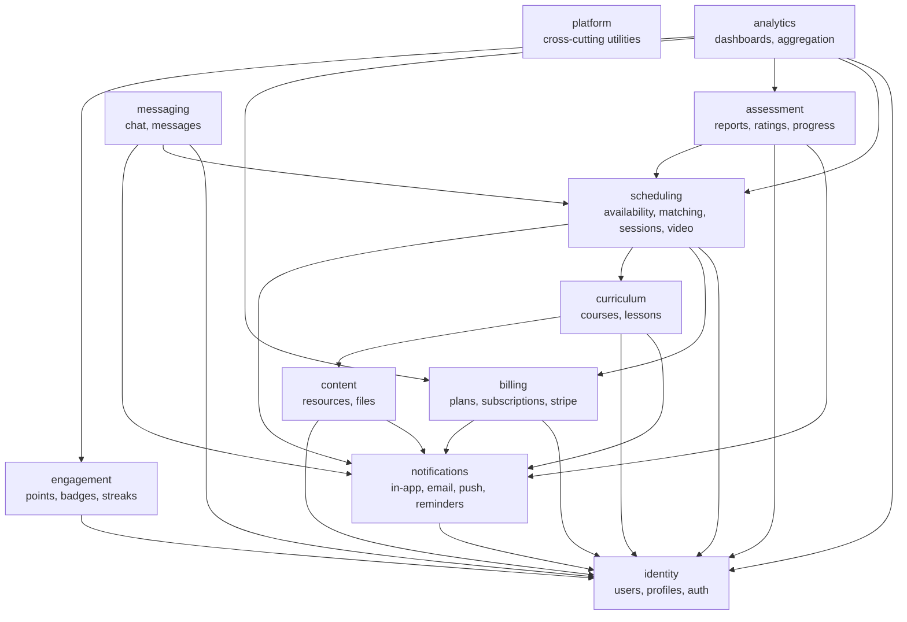

# kaleem Architecture Overview

## Module map

## Boundary rules

1. No business module imports another module's models
2. All inter-module calls go through `<module>/services.py`
3. `analytics` is read-only — it never writes to other modules
4. `platform` is imported by all, imports from none
5. No circular dependencies at the module level
6. Enforced by `import-linter` in CI

## Current state

**Phase 0** — only `platform` module exists. All other modules are planned for later phases.

## Dashboard: the service worker and the offline copy

The dashboard registers a service worker (ADR-0065). It caches only the build's own files and never
answers an API request; updates wait for a tap and never happen in a call. The page keeps a small,
named-field copy of the signed-in person's upcoming lessons in Cache Storage, shown only on the
offline screen and wiped on sign-out, deletion, a lost session, an account switch, age and the kill
switch. `requireAuth` throws `OfflineError` instead of redirecting when there is no connection. Code:
`dashboard/src/sw/` (the worker), `src/lib/offline/` (projection and store), `src/lib/sw/register.ts`
(lazy registration), `src/features/shell/OfflineScreen.tsx`. Operating it: `docs/runbook/service-worker.md`.
