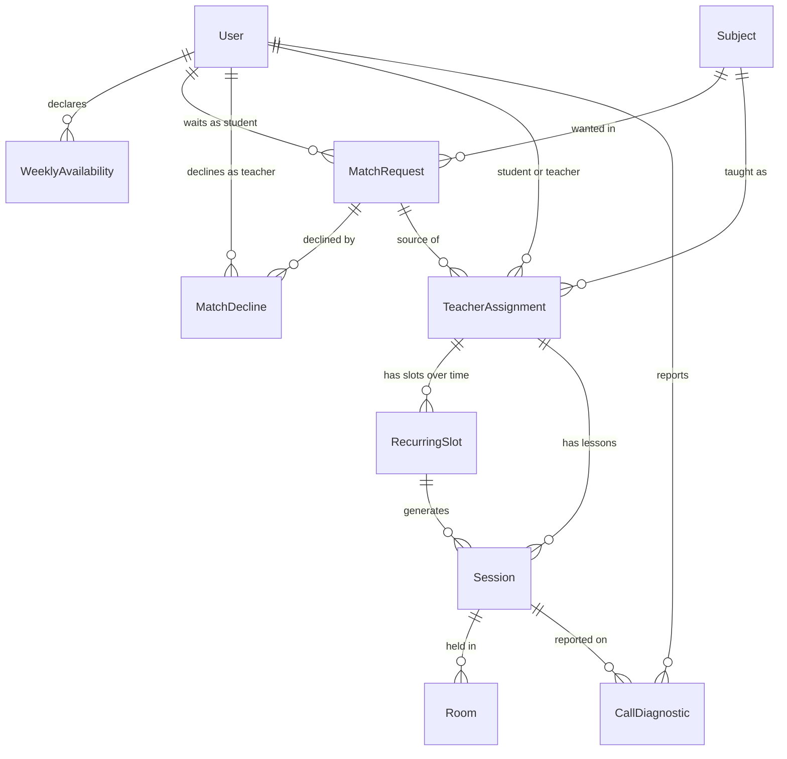

# scheduling — architecture

Who teaches whom, and when: weekly availability, matching a student to a teacher, the standing
weekly time and the lessons it generates, the monthly quota those lessons spend, and the video
room each lesson is held in. It is the largest module in the codebase, and the only one with a
second deployable (the signaling service) next to it.

**Describes backend `18888b2` · dashboard `e61e23e`** (the `origin/main` heads on 2026-10-18,
the typed read API from `ana-scheduling-read-api` included; the lesson close-out of
`ana-session-outcomes` is written up here but lands after those SHAs). A change to the module updates
the section it touches in the same PR; the SHAs above say how fresh the rest is.

Specs: `2026-06-25-scheduling-availability-design.md` (availability) ·
`2026-09-04-phase-c0-matching-inputs-design.md` (C0) · `2026-09-05-phase-c1-matching-design.md`
(C1) · `2026-09-05-phase-c2-booking-quota-design.md` (C2) · `2026-09-05-phase-c3a-video-room-design.md`
(C3a) · `2026-09-06-phase-c3b-signaling-design.md` (C3b) · `2026-09-06-phase-c3c-turn-design.md`
(C3c) · `2026-09-07-phase-c3d-call-client-design.md` (C3d) ·
`2026-09-07-phase-c3e-a-call-diagnostics-design.md` (C3e-a) ·
`2026-09-07-phase-c3e-b-browser-hardening-design.md` (C3e-b) ·
`2026-09-07-shared-signaling-service-design.md` · `2026-09-12-call-fixes-design.md` (C5) ·
`2026-09-12-schedule-call-audit-fixes-design.md` (C6) · `2026-10-18-ana-scheduling-read-api-design.md` ·
`2026-10-18-ana-session-outcomes-design.md` (lesson close-out).
ADRs: 0033 (depends on curriculum and billing) · 0034 (custom WebRTC, group lessons deferred) ·
0035 (signaling as a separate service) · 0036 (feature components split hook and presentation) ·
0037 (signaling is shared, not blue-green) · 0039 (pre-negotiated transceivers) · 0046 (v1
roadmap reconciliation, which drops trials) · 0054 (live-lesson captions: the stated gap). Operations live in `docs/runbook/signaling.md`,
`turn.md` and `video-call.md`, not here.

## The four fixed fields

The roadmap (Section 2) requires these four at the top of every module's doc.

### Owns

Eight tables, all in `kaleem/scheduling/models.py`, migrations `0001`–`0012`. No other module
reads or writes them.

`WeeklyAvailability` · `MatchRequest` · `MatchDecline` · `TeacherAssignment` · `RecurringSlot` ·
`Session` · `Room` · `CallDiagnostic`

The signaling service holds room membership in process memory only and owns no table.

### Public API

`kaleem.scheduling.services` is the only thing another module may import. It returns frozen
DTOs (`SessionInfo`, `AssignmentInfo`) and `TypedDict`s, never models, so a caller cannot walk
into a model or `save()` one. The DTOs carry ids, times, status, subject and people's
`full_name`. They never carry an email (ADR-0023).

| Group | Functions |
| --- | --- |
| Availability | `get_availability`, `set_availability`, `merge_ranges`, `to_utc_intervals`, `to_utc_intervals_for` |
| Quota | `get_quota` |
| User-scoped reads | `upcoming_sessions`, `sessions_between`, `session_history`, `next_sessions`, `next_session_per_child`, `active_assignments`, `sessions_to_close` |
| Close-out window | `CLOSE_OUT_WINDOW`, `close_out_window`, `may_close` |
| Id-scoped reads | `get_session`, `is_session_party`, `is_assignment_party`, `is_active_teacher_of` |

`services.py` keeps two rules apart, and so must a caller:

- **User-scoped reads apply the role rule.** `role` is `None`, `"student"`, `"teacher"` or
  `"parent"`; any other value raises `ValidationError`. `None` means the user's own sessions
  as a student, their own as a teacher, and their children's. `"teacher"` gives a teacher who
  is also a parent a clean teaching view; `"parent"` with no children returns nothing.
- **Id-scoped reads apply no visibility rule: the caller authorizes.** `get_session` raises
  `NotFoundError` for an unknown id and says nothing about who may look. `is_session_party`
  (student, teacher, or a parent of the student) is who may *see and cancel* a lesson. It is
  not who may *enter* one: `rooms.is_participant` is, and it excludes parents.

Bounds are constants: `MAX_WINDOW` 31 days for `sessions_between`, `MAX_HISTORY_LIMIT` 100 for
`session_history` (a keyset page, newest first), `MAX_NEXT_LIMIT` 50 for `next_sessions`.
`SessionInfo.outcome` is `None` until a lesson is closed out, and a caller must never read `None`
as an outcome (see "Closing a lesson").
Every read except `get_quota` takes UTC-aware instants and raises `ValidationError` on a naive
one. Turning a viewer's local day into instants, DST included, is the caller's job.

`booking`, `matching`, `rooms` and `diagnostics` are **internal**. Only the module's own views,
tasks and management commands call them. Their import direction is one way: they import
`services`, never the reverse (`matching` already imports `to_utc_intervals`, so a
`services -> booking` import would be a cycle that fails at import time).

### Depends on

- **`identity`, `curriculum` and `billing`, each through its `services` module only**
  (ADR-0033). What it calls: identity for users, profiles, children and the timezone;
  curriculum for a teacher's subject ids and the students' interest pairs; billing for
  `get_session_allowance`, `is_entitled_to` and `Capability.BOOK_SESSION`. The foreign keys to
  `curriculum.Subject` are written as a string label, which keeps a real database relation
  without an import.
- **`signaling.tokens`**, one token codec shared with the signaling service (ADR-0035). The
  arrow runs one way: `kaleem.scheduling` imports `signaling`, and a contract forbids the
  reverse.
- `kaleem.platform` (typed exceptions), as every module does.

Held by five import-linter contracts in `pyproject.toml`:

| Contract | Holds |
| --- | --- |
| `scheduling imports no business modules except identity, curriculum and billing` | No edge to assessment, content, messaging, notifications, engagement or analytics |
| `scheduling does not reach past identity's public API` | No direct `identity.models` import |
| `scheduling does not reach past curriculum's public API` | No direct `curriculum.models` import |
| `scheduling does not reach past billing's public API` | No direct `billing.models` import |
| `signaling imports neither kaleem nor django` | The signaling service stays a plain ASGI app with no ORM, settings or database |

The three "does not reach past" contracts use `allow_indirect_imports`, so the legitimate
`scheduling.services -> identity.services -> identity.models` chain stays legal while a direct
model import fails. Scheduling's own tests are exempted, because they build fixtures from the
other modules' models. The last contract sets `include_external_packages`, without which the
`django` half would silently pass.

**Scheduling provides the teaching link without being imported** (ADR-0049).
`SchedulingConfig.ready()` registers `is_active_teacher_of` and `active_student_ids_of`
(ACTIVE assignments, any subject) with `kaleem.platform.teaching`, so `content` and
`curriculum` can ask who teaches whom through the port. The `scheduling imports no business
modules ...` contract also ignores exactly one transitive edge, `kaleem.curriculum.** ->
kaleem.content.services`, because curriculum may now call content and scheduling reaches
curriculum; a direct `scheduling -> content` import still breaks it.

**No other module imports scheduling today.** It is wired in only from `config` (the API
router, the app list, the beat schedule, the `VIDEO_PROVIDER` setting). The roadmap's planned
`scheduling -> notifications` edge does not exist yet; `ntf-*` opens it.

### Does not do

- **Notifications.** Nothing emails or pushes about a match, a cancellation or a reminder. That
  is `ntf-*` work, and the producers will call `notifications`.
- **Trials.** Dropped in ADR-0046. The roadmap's old `TrialRequest` / `TrialSession` entry is stale.
- **Group lessons.** A room holds exactly two participants (ADR-0034).
- **Session reports and ratings.** `assessment`.
- **Teacher earnings.** `billing` (`pay-earnings-ledger`).
- **Media beyond a relay, and recording.** The module mints TURN credentials; it never sees,
  mixes or stores media.
- **Booking for a student with more than one active subject.** `claim_slot` carries no subject
  parameter, so it refuses with a `ValidationError` rather than guess which assignment a lesson
  belongs to.

## Data model

`User` and `Subject` belong to `identity` and `curriculum`.

- **WeeklyAvailability** — one local-time range per row: `weekday` 0–6, `start_time`,
  `end_time`. Held by `availability_end_after_start` and `availability_weekday_in_range`; the
  second exists because a service-validated weekday of 7 could still be inserted from a shell
  and then makes `__str__` raise. A user's timezone lives on `identity`'s `User`, not here;
  `set_availability` replaces the whole set in one transaction, merging touching and
  overlapping ranges first.
- **MatchRequest** — a student waiting for a teacher in one subject, status `open` /
  `matched` / `cancelled`. `unique_open_match_request` is *partial* (only `open` rows), because
  a rematched student legitimately accumulates rows over time.
- **MatchDecline** — a teacher opting out of one request. The only reason offers need any
  storage at all. `unique_match_decline` on `(request, teacher)`.
- **TeacherAssignment** — an ongoing 1-on-1 relationship, status `active` / `ended`.
  Many-over-time (rule #7): reassignment writes a new row and ends the old one.
  `unique_active_assignment` on `(student, subject)` where active is the backstop for the
  accept race. `source_request` is `RESTRICT`, not `PROTECT` (see below).
- **RecurringSlot** — a student's standing weekly time. `weekday` and `start_time` are **UTC**.
  `teacher` is denormalised from the assignment so double-booking can be a database constraint:
  `unique_active_slot_per_assignment` (one active slot per assignment) and
  `unique_active_teacher_slot` on `(teacher, weekday, start_time)` where active. The latter
  catches exact collisions only; a partial overlap (10:00 against 10:30) cannot be a unique
  index and is refused inside the claiming transaction.
- **Session** — one lesson at one instant, status `scheduled` / `completed` / `cancelled`. A
  row exists on ordinary weeks, not only on deviating ones. `unique_session_instant` on
  `(assignment, starts_at)` makes generation idempotent. `duration_minutes` defaults to
  `SESSION_DURATION_MINUTES` (60). It also stores `cancelled_by`, `cancelled_at`, `cycle_end`
  (the billing period it counts against, identified by its end) and `consumes_quota`. A
  closed-out lesson also carries `outcome` (`held` / `student_absent` / `teacher_absent`) and
  `outcome_recorded_at`, both nullable. The check constraint `session_outcome_only_when_completed`
  refuses an outcome on a lesson that is not `completed`, for every writer.
- **Room** — a video room for one session, a row over time rather than a field on `Session`
  (rule #7): a provider failure or a rescheduled lesson can mean a second room. `provider`
  records which adapter minted it; `signaling_url` records where it lives. At most one is
  active per session, held by `room_one_active_per_session`, partial on `status` (a unique
  index over a nullable `ended_at` would constrain nothing, since NULLs are distinct).
- **CallDiagnostic** — one failure reported by one participant's browser: closed `code`,
  `user_agent`, redacted `stats` (JSON, nullable), `created_at`. Indexed on `created_at` for
  the retention job.

**Why the delete rules differ.** Everything hangs off `User` by cascade, so a delete rule must
let a same-operation cascade through. `PROTECT` is evaluated per cascade branch and cannot tell
an orphaning delete from a legitimate one; it broke deleting any matched student in C1. So:

- `MatchRequest.student`, `TeacherAssignment.student` / `teacher`, `Session.assignment`,
  `Room.session` and `CallDiagnostic.session` are `CASCADE`: none has a meaning apart from its
  parent.
- `TeacherAssignment.source_request` and `Session.slot` are `RESTRICT`. They keep the guard
  against orphaning a row by deleting its source alone, and still allow both to leave together.
  They are not the same guard twice: `Session.assignment` cascades because a session cannot
  outlive its assignment, while `Session.slot` restricts because deleting a slot must not
  silently strand its lessons.
- `Session.cancelled_by` is `SET_NULL`: a cancelled lesson survives its canceller.

**Two clocks.** `WeeklyAvailability` stores *local* wall-clock time because it belongs to one
person in one timezone. A `RecurringSlot` belongs to *two* people in two zones, so a local time
would have no single meaning, and a student who travels would silently move their teacher's
lesson. Slots and sessions are UTC. The two meet in `to_utc_intervals`, which converts for the
reference week of a given date, so DST is resolved per week.

**Saturday-first.** `weekday` 0 is Saturday and 6 is Friday (`WEEKDAY_LABELS`). Python's
Monday-0 weekday is converted at the edges (`_kaleem_weekday`, `_week_saturday`).

**`consumes_quota` is stored, not inferred from status.** A session cancelled 30 hours ahead
and one cancelled 30 minutes ahead are both `cancelled`, and only the first returns the unit.
Storing the fact makes the quota a filter and leaves an audit trail of why a unit came back.

## Matching

Files: `matching.py`, views in `api/views.py`. Specs C0 and C1.

**Offers are computed, never stored.** A materialised offer table would go stale the moment a
teacher added a subject or edited availability, and an unmatched request would then need a job
to re-fan-out. Here "re-evaluated when the pool changes" is a property of the query: a request
stays `open` indefinitely, and `list_offers_for` recomputes who may see it on every read.

**One hard-filter rule, in one place.** `_passes_hard_filters` takes already-fetched values and
returns whether a teacher may be offered a request: the teacher declared a gender, the student
has a stated preference, the request's subject is one the teacher teaches, `gender_allows`,
and the two share more than zero minutes of availability. `is_eligible` (which guards accept
and decline) and `list_offers_for` (which decides what a teacher sees) both call it, with
values fetched singly or in bulk, so the two cannot drift apart.

It **fails closed on both unknowns.** An undeclared teacher gender is not a wildcard, and a
missing student profile is "we don't know", which is never read as `no_preference`. Collapsing
either would hand a child a teacher they may have ruled out.

**Overlap is computed on instants.** `overlap_intervals` intersects the two people's UTC
intervals for the reference week and is the single source of truth for "when are these two both
free"; `overlap_minutes` sums it and booking reuses it, so matching and booking cannot disagree
about when a lesson could happen. Comparing local wall-clock pairs would pair people who are
asleep. The inbox batches the reads (`to_utc_intervals_for`, `get_users`,
`get_student_preferences`) to avoid an N+1. Offers are sorted best fit first (most overlap),
then longest wait; rank orders the list and decides nothing, because the first to accept wins.

**`sync_match_requests` is pull-based.** Billing must never import scheduling, so entitlement
is asked for rather than announced. For every student interest pair that has no active
assignment and no open request, it opens a request if the student is entitled to
`Capability.BOOK_SESSION`. It is idempotent, so running it on a read is correct, merely
repeated, and it needs no event bus and no beat entry. It runs as a side effect of
`GET match-offers/` and `GET match-requests/mine/`, and by hand through the
`sync_match_requests` management command for staff. Each create sits in its own savepoint, so
an `IntegrityError` from a concurrent reconcile (the partial unique index catching a duplicate)
is the correct end state rather than a failure that poisons the request's transaction.

**The accept race.** `accept_offer` is atomic. `select_for_update` serialises concurrent
accepts on the request row; eligibility is re-checked *inside* the transaction, because the
inbox that produced the click may be seconds stale; then the request becomes `matched` and an
assignment is created. A non-open request is a `ConflictError` (409), an ineligible teacher a
`PermissionDeniedError`, an unknown id a `NotFoundError`. `unique_active_assignment` is the
backstop, and an `IntegrityError` from it is translated into the same 409 rather than leaking
as a 500. `decline_offer` has the same guards and is idempotent (`get_or_create`).

`list_assignments_for` is role-aware: each side sees the other's name, never their email, and a
parent also sees their children's active assignments.

## Booking and quota

Files: `booking.py`, quota in `services.py`. Spec C2. Matching answers *who* teaches a
student; booking answers *when*.

**Slot options.** `slot_options` returns weekly start times where both people are free for a
whole session (`_fitting_candidates` over the overlap windows, stepping by 60 minutes) and the
teacher is not already booked there. `_conflicts` compares weekly minutes as a *circular*
distance, so Friday 23:30 and Saturday 00:00 are adjacent: the week wraps.

**Claiming a slot.** `claim_slot` is atomic and closes the double-booking race by locking every
*active assignment of the teacher* before scanning their slots. Locking the slot rows would not
work: `select_for_update` over a queryset that matches nothing locks nothing, so two students
claiming a teacher's first slot would both see an empty scan. Every claimant has an assignment
with that teacher, so that set is never empty. A student may hold one active slot per
assignment (`ConflictError` otherwise).

The two failures are decided together on purpose. A time outside the shared window always
reads as "not available" (`ValidationError`, field `start_time`), regardless of what the
teacher holds there; `ConflictError` ("already booked") is reserved for a time inside the
shared window, so a student cannot enumerate their teacher's other bookings by probing times
outside their own availability.

**Generating sessions.** `generate_sessions` materialises each active slot's sessions for the
current billing cycle, up to the cycle's end. It runs **nightly** (the `scheduling-generate-sessions`
beat entry) and **inline on claim** for that one student, in the claim's transaction, so a
student told "your weekly time is booked" does not then see "no upcoming sessions" for a day.
It is idempotent (`get_or_create` on `(assignment, starts_at)`), and daily rather than fired on
a renewal webhook: an unentitled student generates nothing, and the first run after they are
entitled again fills in the rest of the cycle, which does the work of a late-renewal rule
without a catch-up path for every way a renewal can be late or replayed. It locks per student,
not around the run, so overlapping runs cannot jointly overspend one student's quota. **Quota
is enforced by construction**: the loop stops at the limit, so a fifth session of a
four-session cycle is never written.

**The quota and its cycle key.** `get_quota` asks billing for `(limit, cycle_end)` and counts
`_consumed`. A session counts if `consumes_quota` is true *and* either its stored `cycle_end`
equals the one billing reports now, *or* that stored instant has not yet passed. The second
clause is the point. Four billing paths write `current_period_end`; a rewrite differing by one
second inside a cycle, under plain equality, would drop `used` to zero and let the next nightly
run issue a second full allowance. The relaxed key can only count *more* sessions than equality
did, so the failure it replaces is unreachable through it, and a finished cycle stops counting
on its own, which is how a student regains their allowance on renewal with nothing to clean up.
Status is deliberately not in the filter: a completed lesson and a late-cancelled one both
consumed their unit.

**Cancelling.** `cancel_session` may be called by the student, the teacher or a parent of the
student (`is_assignment_party`). `_apply_cancellation` decides the refund and is shared with
`end_slot`, so ending a slot cannot become a way to reclaim a unit that a direct cancellation
would have spent:

- A **teacher** cancelling always refunds, at any notice.
- Anyone else refunds only when the lesson starts at least `CANCELLATION_NOTICE` (24 hours)
  away; exactly 24 hours counts as in time.
- The result is stored in `consumes_quota`. The session payload's `cancellation_refunds` is
  computed server-side against the server's clock, so the interface states the consequence
  before the click and the rule lives in one place.

Cancelling also ends the lesson's room (see Rooms).

**Ending a slot.** `end_slot` (a party to the assignment only) cancels the future `scheduled`
sessions of that slot under the same rule, then marks the slot `ended`.

**Closing a lesson.** Spec `2026-10-18-ana-session-outcomes-design.md`, resolving
dec-lesson-outcomes. `completed` means "closed out", and `Session.outcome` says how it went:

- `held` and `student_absent` are recorded by the lesson's teacher, through `complete_session`
  and `mark_student_absent`. Both keep `consumes_quota` true: the unit stays spent.
- `teacher_absent` exists in the enum but nothing in this module writes it. It is set only by
  staff adjudication, built later by `sched-teacher-no-show`.
- **The window** is `starts_at <= now < starts_at + CLOSE_OUT_WINDOW` (7 days), measured from the
  *start*, in UTC instants. It is written once, in `services.close_out_window`; `booking` uses it
  to refuse and `services.may_close` uses it to answer, so they cannot disagree. A lesson nobody
  closes stays `scheduled` with no outcome. Nothing auto-closes it.
- **The ordered sequence.** Both writers call `booking._close_out`, inside one transaction:
  (1) lock the row, (2) the actor is the lesson's teacher (403), (3) the lesson is `scheduled`
  (409), (4) the window (409, a message per side), (5) write status, outcome and
  `outcome_recorded_at`, (6) *reserved: the earning line, `pay-earnings-ledger`*, (7) end the
  lesson's rooms, (8) *reserved: the `on_commit` publish and notices, `eng-event-bus` and the
  notification units*. The refusal order is the order of steps 2 to 4, so a non-party learns
  nothing about another person's lesson. Each later unit adds its step in its slot and extends
  `tests/test_close_out_matrix.py`, the one table of action x actor x prior status x clock.
- **Closing ends the call.** The window opens at the start, so a teacher can close a lesson
  while its call is running, and that ends the room.
- **Cancelling is unchanged.** How cancelling relates to the close-out window is a later
  unit's decision; the matrix pins today's cancel rows so that change is deliberate.
- **Blue-green.** Both columns are nullable with no default, so the previous release keeps
  working beside this one. A lesson it completes during a deploy keeps a NULL outcome.
  Migration `0013_session_outcome` backfilled existing `completed` rows as `held`.

## Rooms

Files: `rooms.py`, `providers/`. Spec C3a, ADR-0034.

**The provider seam.** `VideoProvider` is a `Protocol` with `create_room`, `get_join_url` and
`end_room`, selected by the `VIDEO_PROVIDER` setting (a dotted path, resolved by
`get_provider()`). `FakeVideoProvider` is the default setting: a real implementation that mints deterministic ids and per-user expiring URLs, which
is what gave C3a real tests before any media code existed. `SignalingProvider` is the real one.
The provider layer never touches an ORM object: it takes `RoomRequest`, `ProviderRoom` and
`Participant` value objects and returns a `JoinGrant`.

**The join window.** `join_window(session)` is `starts_at - JOIN_OPENS_BEFORE` (10 minutes) to
`starts_at + duration + JOIN_CLOSES_AFTER` (15 minutes). It is pure, with no queries, and
defined once so the interface and the guard cannot disagree. `can_join_at` is sent to clients
so a countdown runs locally instead of polling.

**`is_participant` is the entry rule, and it excludes parents.** The actor must be the
session's teacher or student. A parent may see the schedule but may not enter the lesson, and
the rule is about *this* session, not about roles: a teacher who also has a child on the
platform is a participant in the lessons they teach. It is written once and called by the join
guard, the diagnostics endpoint and the session payload (`may_join`), so widening it (a
co-teacher, an observer) is one line that lands on all three. `_participant` maps an admitted
person to teacher or student; its final `raise AssertionError` exists to catch the predicate
drifting from it, rather than handing an unrecognised person the student's seat.

**Joining.** `join_session` authorizes, lazily ensures a room, and mints a grant. The checks
run in a deliberate order: who you are (403), whether the session is `scheduled` (409), whether
it is inside the window (409, "not open yet" or "has closed"), so a non-participant learns
nothing about whether someone else's lesson is running. The session row is locked
(`of=("self",)`, so only that row, not the assignment or subject) only for the check-and-create
block; the grant is minted outside the lock. **The grant expires exactly when the window
closes**, and the TURN credentials derive from the same instant, so nothing disagrees about when
a person's access ends.

**One active room per session.** `_ensure_room` reuses the active room, or creates one lazily
on first join (not eagerly for every generated session), writing the row only after the
provider returns so an outage leaves no half-created room. A provider failure is logged with its
traceback and re-raised as a typed `ExternalServiceError` (rule #8). If an active room's
`provider` differs from the configured one it refuses rather than ask the new provider for a
URL to the old provider's room; the operator's fix is to end the active rooms.

**`Room.signaling_url`** records where a room lives, captured at creation. It was introduced
when the two deploy colours each handed out their own signaling host, which could land two
participants of one lesson in different one-peer rooms. ADR-0037 made signaling one shared
host, so that split can no longer happen. The column stays as the durable record and the
tripwire if a per-host scheme returns; `get_join_url` still prefers the row's value over
settings.

**Rooms end** when a session is cancelled or closed out (`end_rooms_for_session`), which is what
gives `Room.Status.ENDED` a production path. The local row is marked `ended` even if the
provider call fails, because reusing a room the provider has dropped is worse than minting a new
one. Migration `0009_end_active_rooms` ended every active room once, for rooms written under
the old per-colour scheme; it is not a recurring step.

## Diagnostics

Files: `diagnostics.py`, `CallDiagnostic`. Spec C3e-a.

Exists because the browsers C3e targets (Safari, iOS) cannot be run in this project, so a row
here is the only evidence a failure there ever produces.

- **A closed vocabulary.** `CallDiagnostic.Code` has ten values: `gum-denied`,
  `gum-not-found`, `gum-in-use`, `autoplay-blocked`, `gum-no-gesture`,
  `ice-restart-unsupported`, `backgrounded`, `device-lost`, `screenshare-failed` and
  `line-mismatch`. The serializer is a `ChoiceField` against the model's own choices, so an
  unrecognised code is a 400, not a stored row. `line-mismatch` is a mismatch of negotiated
  media lines, which only a pair of mismatched dashboard bundles (a lesson in progress across a
  deploy) can produce under ADR-0039.
- **The user agent is read server-side** from the request header and never accepted from the
  body, so a client cannot forge the one field the phase exists to read. It is truncated to
  `USER_AGENT_MAX_LENGTH` (512) rather than rejected, so an unusually long one does not cost the
  report.
- **Authorization is `rooms.is_participant`**, the same predicate as the join guard.
- **Stats are redacted in the browser**, by an allow-list of named fields (`redactStats.ts`), so
  a network address never reaches the server. The server stores the JSON as given and does not
  re-validate its shape.
- **Retention is 90 days**: `RETENTION`, enforced by `purge_expired`, run daily by the
  `scheduling-purge-call-diagnostics` beat entry.
- **Throttled** at 20 per hour per user (`call-diagnostics`), because a broken browser is
  exactly the client that retries in a loop.

## Signaling and TURN

Files: `signaling/` (top-level package, not under `kaleem/`), `providers/signaling_provider.py`,
`providers/turn.py`. Specs C3b and C3c, ADR-0035, ADR-0037.

**The service.** `signaling.app` is a Starlette WebSocket relay for one lesson's two
participants. It shares the backend image and imports no Django (the contract above): no ORM,
no settings module, no database. Its entire input is a socket and a signed token. It exposes
`/ws/rooms/{room_id}` and a health route that proves it can sign a token, not merely that the
port is open. **It is a shared service, not blue-green** (ADR-0037): one host serves both
deploy colours.

**The token.** The API mints a `RoomToken` (room id, user id, `is_teacher`, expiry), HMAC-signed
with a secret shared by the API and signaling. It is a capability scoped to one room and one
participant, not a login (ADR-0003 forbids bearer tokens as user authentication). Verification
compares in constant time, refuses a malformed or non-ASCII value as an ordinary refusal, checks
the claims' types, and rejects an expired token or one signed for a different room.
`signaling.tokens` is pure stdlib so both processes use one codec.

**Where the token travels.** In the WebSocket subprotocol, never in a query string, which would
leak to `Referer`, browser history and any proxy in front. The client opens
`new WebSocket(join_url, [SUBPROTOCOL, token])`, protocol name first, with
`SUBPROTOCOL = "kaleem.signaling.v1"`. Any other shape (no header, the name alone, extra
entries, the wrong order) is treated as no credential and refused. Refusals are logged by
*reason* only, never the token.

**Close codes.** Application codes in the 4000 range, one per reason so the client can tell
them apart:

| Code | Meaning |
| --- | --- |
| `4400` | A frame the service does not accept: not text, not JSON, not an object, or a `type` outside the relayable set |
| `4401` | Unauthorized: no credential, a bad or expired token, or a token for another room |
| `4409` | Room full: a third participant tried to join |
| `4410` | Replaced: this participant opened a newer socket and took over their seat. Not an error; the client must not retry |

A refusal is accept-then-close, so the browser sees the code rather than a bare handshake
failure.

**The room.** `RoomRegistry` is a process-local dict with `MAX_PEERS = 2`. A seat belongs to a
*participant* (`user_id`), not to a socket: a second socket from the same person *replaces* the
first (a reconnect after a dropped network, or a second tab) rather than filling the room and
locking their teacher out. Freeing the seat and announcing `peer-left` are one fact,
in one `finally`, so a socket that dies mid-announcement still frees its seat and the survivor
always gets a `peer-left` to match its `peer-joined`. A displaced socket's cleanup announces nothing
(`registry.leave` returns False). The registry assumes one
process (ADR-0035's one-replica constraint, which the single shared host of ADR-0037 keeps), so
two peers of a room always reach the same one. If that stops being true, `signaling/rooms.py`
is the file that grows a fan-out layer.

**Relayed messages.** The relay passes frames to the *other* peer only, and drops them when no
one is there. It does not read SDP or the `media-state` booleans. The relayable types are
`offer`, `answer`, `ice` and `media-state`. `media-state` exists because the browser gives the
peers no other way to learn that a share stopped or a camera was released. Widening the set is
a breaking change in one direction only (a client sending a type the server does not know is
closed with `4400` mid-call), so the server deploys first. By convention the teacher offers and
the student answers; the grant carries `is_teacher` so the client need not guess.

**TURN.** About one connection in six cannot go peer-to-peer. `providers/turn.py` builds the
ICE server list from the `TURN_URLS` setting: STUN entries without a credential, TURN entries
with a time-limited credential from coturn's REST scheme (an HMAC over `expiry:user_id` with the
shared secret, mandated by coturn). coturn holds only the shared secret and has no account
table, so **the expiry in the username is the whole revocation story**, which is why it is the
room's own join-window close and not a duration invented here. The functions are pure: no
settings read, no clock.

**Fail closed.** `SignalingProvider.__init__` raises `ImproperlyConfigured` unless both the
signaling secret and URL and both the TURN secret and URLs are set, so a misconfigured
deployment is a loud failure at the point of use and not a broken join link handed to a student
mid-lesson. `signaling.app` likewise fails loudly, not silently, without its secret.

## HTTP surface

All under `/api/v1/scheduling/`, mounted through `config.api_router` (ADR-0029). Seventeen routes.
"Profile" means the user holds that profile; a person may hold several.

| Method | Path | Who | Notes |
| --- | --- | --- | --- |
| `GET` `PUT` | `me/availability/` | student or teacher profile | `PUT` replaces the set and may set the timezone |
| `GET` | `match-offers/` | teacher | Reconciles first (`sync_match_requests`), then lists offers |
| `POST` | `match-offers/<int:request_id>/accept/` | teacher | 201; 404 unknown, 409 taken, 403 ineligible |
| `POST` | `match-offers/<int:request_id>/decline/` | teacher | 204; idempotent |
| `GET` | `match-requests/mine/` | student | Reconciles first; cancelled requests excluded |
| `GET` | `assignments/` | student, teacher or parent profile | A parent sees their children's |
| `GET` | `slot-options/` | student | Computed candidates, not rows |
| `GET` `POST` | `slots/` | student | `POST` claims (201); `GET` is 404 when there is no active slot |
| `DELETE` | `slots/<int:slot_id>/` | student | 204; the service requires a party to the assignment |
| `GET` | `sessions/` | student, teacher or parent profile | Upcoming, every status; payload adds `may_cancel`, `cancellation_refunds`, `can_join_at`, `may_join`, `may_complete`, `outcome` |
| `GET` | `sessions/to-close/` | teacher | The teacher's `scheduled` lessons that have started and are inside the 7-day window, oldest first; 403 without a teacher profile |
| `POST` | `sessions/<int:session_id>/cancel/` | the student, the teacher or a parent of the student | Refund rule applied; ends the room |
| `POST` | `sessions/<int:session_id>/complete/` | the session's teacher | Records `held`. 409 before the start, after the window, or when not `scheduled`. Ends the room |
| `POST` | `sessions/<int:session_id>/no-show/` | the session's teacher | Records `student_absent`, same guard as `complete/`. Ends the room |
| `POST` | `sessions/<int:session_id>/join/` | a participant (teacher or student, not a parent) | Throttled `session-join`, 30 per hour; `POST` because it can create a room |
| `POST` | `sessions/<int:session_id>/diagnostics/` | a participant | Throttled `call-diagnostics`, 20 per hour; 201 |
| `GET` | `quota/` | student | 404 when billing reports no allowance |

The view layer is thin: it checks the profile, calls one service, and serializes. Cancel and
complete return a payload built from the public read after the transaction committed, never
from the model the mutation returned. `_today()` is a seam so a test can pin the reference week.

## Jobs

| What | Where | When |
| --- | --- | --- |
| `scheduling-generate-sessions` | `tasks.generate_sessions` -> `booking.generate_sessions` | Beat, `crontab(hour="2", minute="43")`. Retries only on `OperationalError`, for lock contention with an interactive `claim_slot` |
| `scheduling-purge-call-diagnostics` | `tasks.purge_call_diagnostics` -> `diagnostics.purge_expired` | Beat, `crontab(hour="4", minute="11")`, after the other nightly jobs |
| `sync_match_requests` | management command | By hand, for staff. Production never strictly needs it: the same reconcile runs on read |
| `seed_e2e_matching` | management command | Fixture for the e2e suite; separate from identity's `seed_e2e` because identity may not import curriculum or billing |

Beat times are crontab hours in the Celery timezone, which `config/settings/base.py` sets from
`TIME_ZONE` (UTC). The task bodies stay thin wrappers so the logic is testable without a broker
and callable by hand from a shell.

## Personal data held

Described here, not changed by this doc (ADR-0023). Scheduling holds, per person:

- **Availability**: weekly local-time ranges.
- **Match requests and declines**: which student wants which subject, and which teacher declined.
- **Assignments**: who teaches whom, in what subject, since when.
- **Slots and sessions**: the standing weekly time and each lesson's instant, status, and, for a
  cancelled lesson, who cancelled it and when.
- **Rooms**: provider, an external id and the signaling host. No media.
- **Attendance**: whether a student attended a lesson (`outcome`: `held` / `student_absent`)
  and when the teacher recorded it (`outcome_recorded_at`). Students may be minors, so this is
  children's attendance data. Kept for the life of the `Session` row, visible to the lesson's
  student, teacher and the student's parents, and to staff in Django admin. It is the basis for
  attendance, reports, pay and no-show handling.
- **Call diagnostics**: the reporting user, the user agent, and redacted client stats.

The signaling service keeps user ids in process memory for the life of a socket and persists
nothing.

**Retention.** The one period in code is 90 days for call diagnostics (`diagnostics.RETENTION`).
Nothing else in the module is purged.

**Registry.** Scheduling has **not joined the personal-data registry** (`docs/architecture/platform.md`).
It sits on the pending lists in `tests/test_personal_data_hooks_cover_every_model.py`, which
`lb-gdpr-data-export` and `lb-gdpr-erasure` clear. A new scheduling model fails that guard until
the module has hooks.

## Clients

The dashboard uses the module through four routes, each a thin page over a feature folder:

| Route | Feature folders |
| --- | --- |
| `/availability` | `features/scheduling` (weekly editor, timezone bar, unsaved-changes guard) |
| `/match-requests` | `features/matching` (teacher offer list, student's teacher card, parent's children's teachers) |
| `/schedule` | `features/booking` (claim a slot, session list, cancel dialog, quota badge, join button) |
| `/sessions/$sessionId/room` | `features/call` (lobby, call room, controls, diagnostics reporter) |

The folder names diverge from the backend, which keeps booking inside `scheduling`
(`ISSUES.md`). Feature components split into a hook and a presentation component (ADR-0036).
The call client's internals are covered by ADR-0036, ADR-0039 and `docs/runbook/video-call.md`,
and are not repeated here.

## Deliberately not here

- **Notifications** on match, cancel or reminder (`ntf-*`).
- **Trials** (ADR-0046) and **group lessons** (ADR-0034).
- **Booking across more than one subject.** One active assignment per student for `claim_slot`.
- **Rescheduling** a single lesson (`sched-reschedule`): today a lesson is cancelled, not moved.
- **Session reports and ratings** (`assessment`). The outcome itself lives here.
- **Setting `teacher_absent`** and its remedy (`sched-teacher-no-show`).
- **Teacher earnings** (`billing`).
- **Parents acting on a child's behalf** beyond viewing and cancelling (`lb-parent-acts-for-child`).
- **Recording**, and any media path beyond a TURN relay.
- **Captions, real-time text and an audio-activity indicator in the call.** None exist, and
  the call has no data channel. A stated launch gap, not an oversight (ADR-0054).
- **Joining the personal-data registry** (see above).
