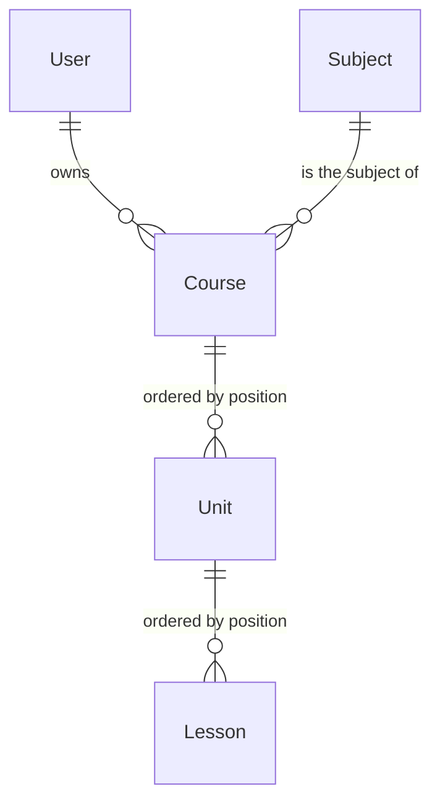

## Goal

A teacher can build a course: a titled course in one subject, made of ordered units, each
made of ordered lessons, and can put units and lessons in a new order with buttons, never
by dragging (WCAG 2.2 SC 2.5.7). This is the roadmap's C2 skeleton (`Course`, `Unit`,
`Lesson`), kept minimal until preview feedback. Assigning lessons, the student's view,
completion and lesson resources are later units (cur-lesson-assignment,
cur-lesson-completion, cur-lesson-resources), and they build on these tables.

What exists today (backend `origin/main` fe415f1, dashboard `origin/main` c70a0f4):

- `curriculum` holds `Subject`, `TeacherSubject` and `StudentSubjectInterest` (migrations
  0001-0003), with `services.py` and three endpoints under `/api/v1/curriculum/`.
- `/curriculum` renders `ModulePlaceholder` ("Coming soon"). Nav shows it to students and
  teachers.
- The dependencies have landed: the export/erase registry
  (`kaleem.platform.personal_data`, ADR-0048), the seed manifest
  (`config/e2e_seeds.txt`, `seed_e2e_all`) and the session wording
  (`src/locales/terminology.test.ts`).

**Decision basis.** dec-cur-terminology (resolved: a live call is a *session*, *lesson*
stays for the curriculum). dec-preview-mode (resolved: run alongside). **dec-cur-ownership
(resolved 2026-10-18: option 1, "private to the teacher; students keep access after a
teacher change").** Under option 1 this unit only needs the first half: a course has one
owning teacher and nobody else reads it. The second half binds cur-lesson-assignment.

## User flow

Teacher (any account with a teacher profile, including one that also has a student
profile):

1. Opens **Curriculum**. Sees their courses, oldest first, each with its subject and unit
   and lesson counts, or an empty state with **New course**.
2. **New course** opens a dialog: title (required), subject (the active subjects), and an
   optional description. A blank or whitespace-only title is refused in the form, and the
   server refuses it too. On success the builder opens at `/curriculum/<id>`.
3. The builder shows the course details (Edit, Delete) and its units in order. Each unit
   shows its lessons in order.
4. **Add unit** and **Add lesson** append at the end. A lesson has a title and an optional
   plain-text body.
5. Every unit and lesson has **Move up** and **Move down** buttons, disabled at the ends.
   A move announces the new position in a polite live region ("Tajweed basics moved to
   position 2 of 4") and keeps focus on the moved item's button. Lessons move within their
   unit only.
6. Rename and delete work on all three levels. Delete asks for confirmation. Deleting a
   course deletes its units and lessons.

Errors: another teacher's course, or one that does not exist, shows a not-found state with
a link back. If the course changed in another tab, a move is refused, the builder reloads
the course and says so. A failed request shows an error with a retry. Saving never loses
what the teacher typed in an open dialog.

Students and parents: no change. A non-teacher on `/curriculum` still sees the placeholder.
The student view arrives with cur-lesson-assignment.

## Data model delta

Migration `curriculum/0004_course_unit_lesson` (the conductor renumbers it at freshness if
another curriculum migration lands first).

- **Course**: `owner` → `AUTH_USER_MODEL` (by string, CASCADE, `related_name="courses"`),
  `subject` → `Subject` (PROTECT; subjects are retired, never deleted), `title`
  (CharField 200), `description` (TextField, blank, at most 2,000 characters), timestamps.
- **Unit**: `course` → `Course` (CASCADE), `title` (200), `position`
  (PositiveIntegerField), timestamps. `UniqueConstraint(course, position)`,
  `deferrable=DEFERRED`, so a reorder can rewrite positions in one transaction.
- **Lesson**: `unit` → `Unit` (CASCADE), `title` (200), `body` (TextField, blank, at most
  20,000 characters, plain text), `position`, timestamps.
  `UniqueConstraint(unit, position)`, deferred.

Positions are 0-based and dense: every add, delete and reorder leaves 0..n-1. Limits,
enforced in services: 50 courses per teacher, 50 units per course, 100 lessons per unit.

No JSON blob (rule 3), and no OneToOne (rule 7). Models carry no logic (rule 4).

**ADR-0023:**

- **What:** text a teacher writes (titles, descriptions, lesson bodies), linked to the
  teacher's user id. Not children's data by design; the builder collects nothing about
  students.
- **Why:** it is the teaching material the teacher builds.
- **How long:** until the teacher deletes it (a hard delete), or until the teacher's
  account is erased.
- **Who sees it:** the owning teacher only, through the API. Not registered in the Django
  admin (dec-admin-surface: break-glass only).

The unit joins the export/erase registry (ADR-0048): `curriculum.courses` exports the
teacher's course trees and erases them by deleting the teacher's courses. Curriculum stays
in `PENDING_EXPORT` and `PENDING_ERASE`, because its three older models are still
uncovered. cur-lesson-assignment must revisit the erase hook once students hold lessons
(option 1's "students keep access").

**Expand/contract:** three new tables and nothing else. The old colour never reads them,
and the previous dashboard bundle never calls the new endpoints.

## API delta

All under `/api/v1/curriculum/` (ADR-0029), session auth and CSRF as everywhere.
Every mutation returns the whole course tree, so the builder replaces its cache in one
step. Order is the array order; positions are not exposed.

| Method | Path | Body | Result |
| --- | --- | --- | --- |
| GET | `courses/` | | `[{id, title, subject, unit_count, lesson_count, updated_at}]` |
| POST | `courses/` | `{title, subject, description?}` | 201, tree |
| GET | `courses/<id>/` | | tree |
| PATCH | `courses/<id>/` | `{title?, subject?, description?}` | tree |
| DELETE | `courses/<id>/` | | 204 |
| POST | `courses/<id>/units/` | `{title}` | 201, tree |
| PUT | `courses/<id>/unit-order/` | `{units: [id, ...]}` | tree |
| PATCH / DELETE | `units/<id>/` | `{title}` | tree |
| POST | `units/<id>/lessons/` | `{title, body?}` | 201, tree |
| PUT | `units/<id>/lesson-order/` | `{lessons: [id, ...]}` | tree |
| PATCH / DELETE | `lessons/<id>/` | `{title?, body?}` | tree |

Tree: `{id, title, subject: {slug, name}, description, created_at, updated_at,
units: [{id, title, lessons: [{id, title, body}]}]}`.

Refusals, all through `platform.exceptions`:

- No teacher profile: 403.
- Not the owner, or no such row: 404, the same response either way.
- Blank or too-long text, an unknown or inactive subject, or a limit reached: 400 with the
  field. A course keeps a subject that is retired later; only changing to one is refused.
- An order list that is not exactly the current set of ids: 409 ("the course changed;
  reload"). Concurrent writes to one course are serialized by locking the course row.

The services add the roadmap's public API, by id per this module's convention:
`create_course`, `list_courses`, `get_course`, `update_course`, `delete_course`,
`add_unit`, `rename_unit`, `delete_unit`, `reorder_units`, `add_lesson`, `update_lesson`,
`delete_lesson` and `reorder_lessons`. Each takes the acting `teacher_id` first and scopes
every query to it.

## Frontend

- `/curriculum` (`curriculum.tsx` becomes a layout with an `Outlet`; the page moves to
  `curriculum.index.tsx`): a teacher sees the course list and **New course**; anyone else
  sees today's placeholder.
- `/curriculum/$courseId` (new, `curriculum.$courseId.tsx`): the builder, teacher only.
- Components in `src/features/curriculum/components/`: `CourseList`, `CourseFormDialog`,
  `CourseBuilder`, `UnitSection`, `LessonRow`, `MoveButtons`, `LessonFormDialog`. States:
  loading skeleton, empty, error with retry, not-found, success.
- `MoveButtons`: two icon buttons with names that carry the item ("Move Tajweed basics
  up"), at least 44 px, from `Button`. Up and down are vertical, so nothing mirrors in RTL.
- Calls go through `curriculumApi` (`src/features/curriculum/api.ts`), with React Query
  hooks in `queries.ts`. Mutations write the returned tree into the course query, and a
  409 refetches.
- Lesson bodies render as text with preserved line breaks; no HTML and no Markdown.
- Copy: the course builder's text lives in its own lazily loaded `curriculum` namespace,
  `src/locales/{en,ar}/curriculum.json` (the file is the namespace's tree, so a key is
  `t("heading")`), not in `common.json`. The `/curriculum` layout route's `loader` loads it
  before anything renders, and components call `useTranslation("curriculum")`. This follows
  the owner's 2026-10-19 bundle-budget decision (option c: per-feature lazily loaded
  catalogues; the 580,000-byte initial-JS budget is not raised). The pattern, its registry
  (`FEATURE_CATALOGUES` in `src/lib/i18n-namespaces.ts`) and its guards are in
  `docs/developer-guide/i18n.md`, "Feature catalogues".
  `modules.curriculum.description` stays in `common.json` (the placeholder, the home tile
  and the terminology test's positive control use it). Home keeps the "Coming soon" badge
  on Curriculum for non-teachers only.
- **In scope, added by the amendment below: the `call` catalogue move.** Moving the
  curriculum copy out was not enough: the initial JS was still 581,064 bytes against the
  580,000 budget (main alone is 579,286). The unit therefore applies the same pattern to
  the video room. The `call` block leaves `common.json` for `src/locales/{en,ar}/call.json`
  and `call` joins `FEATURE_CATALOGUES`. About 30 files under `src/features/call` and the
  `_call` layout route change, and nothing else about the video room's behaviour does.
  - The `_call` route's `loader` loads the catalogue **after** `requireAuth`, so a
    signed-out visitor never downloads it.
  - The three `booking.*` strings the room shares with the schedule stay in `common.json`
    and are read with `{ ns: "common" }`.
  - Guards: `src/lib/i18n-namespaces.test.ts` (no shipped file imports a feature catalogue
    statically, each owning route loads its namespace, `common.json` carries neither
    block, the registry is complete) and `src/locales/parity.test.ts` (catalogues are
    discovered by listing the directory, so a new one is checked in both locales with no
    edit).
  - Result: initial JS 570,611 bytes, 9,389 under the unchanged budget.
- Tokens-only styles, logical properties, both themes, 320 px reflow.

Done means built, deployed to staging and clicked through per dec-d9-substitute (both
themes, Arabic RTL, 320 px).

## Module boundaries

Owner: `curriculum`. It calls `identity.services.get_teacher_profile` (allowed) and
`kaleem.platform` (exceptions, the registry). No contract changes. It does not call
`content` or the teaching port; nothing here involves a student. No events.

Docs: `docs/architecture/curriculum.md` gains the three models, the services, the
endpoints and the ordering rule.

## Out of scope

- Assigning lessons, the student and parent views, completion, lesson resources, and
  moving a lesson to another unit.
- Sharing, duplicating, publishing or archiving courses (dec-cur-ownership options 2-4).
- Reordering courses themselves, rich text, attachments, staff tools.
- Joining `Subject`, `TeacherSubject` or `StudentSubjectInterest` to the registry.
- Moving any other feature's copy to a lazy catalogue. Only `curriculum` and `call` move in
  this unit; later dashboard units follow the pattern as they need it.

## Test plan

Backend (pytest, written first):

- Models: positions are unique per parent at commit (constraint checked with
  `SET CONSTRAINTS ALL IMMEDIATE`), and a swap inside one transaction succeeds.
- Services: create, then the tree; blank and whitespace titles refused; inactive subject
  refused; each limit; add appends; delete renumbers densely; reorder rewrites; a reorder
  with a missing, extra, duplicate or foreign id raises 409 and changes nothing; every
  service returns not found for another teacher's ids.
- API: 403 without a teacher profile; 404 for another teacher's course (same body as a
  missing one); CSRF enforced; each endpoint's shape.
- Registry: `assert_hooks_honour_contract("curriculum.courses", ...)` passes; erase leaves
  another teacher's courses intact.
- Seed: `seed_e2e_curriculum` converges on the same state when run twice and refuses
  `DEBUG=False`.

Dashboard (vitest): list states; dialog refuses a blank title; builder renders the order;
move buttons call the order endpoint with the swapped list, are disabled at the ends,
announce the new position and keep focus; a 409 refetches; non-teachers get the
placeholder; Home's badge rule.

e2e (`e2e/curriculum.spec.ts`, budget 30 s, account `teacher`, seeded by
`seed_e2e_curriculum`):

1. A teacher builds a course (a unit, two lessons), sees it after a reload, then deletes
   it.
2. Reordering with buttons persists: on the seeded course, move the last lesson up and the
   second unit up, reload, and the order holds. The first item's **Move up** is disabled
   (positive control). The builder in Arabic at 320 px has `dir="rtl"`, no sideways
   overflow and no axe violations.
3. An empty title is refused: whitespace only, an error shows, and no course is created
   (checked after a reload).

`/curriculum` as `teacher` joins the Arabic and reflow sweeps. `/curriculum/$courseId`
goes in `NOT_SWEPT` (it needs a course id), with flow 2 as its cover.

## Open questions

- None. **dec-cur-ownership** is resolved (option 1, 2026-10-18).

The owner approved the spec on 2026-10-18 with all its choices: any active subject (not
only those the teacher teaches); hard delete; limits of 50 courses per teacher, 50 units
per course and 100 lessons per unit; lessons stay within their unit; and the Arabic terms
دورة (course), وحدة (unit) and درس (lesson). The Arabic terms still go to hg-arabic-review,
which holds spec closure.

## Amendment, 2026-10-19

The Frontend section's Copy bullet originally said "new keys under `curriculum.*` in `en`
and `ar`", that is, inside `common.json`. Building it showed the bundle budget could not
absorb that, and the owner chose per-feature lazy catalogues (option c) the same day. The
Copy bullet now says what was built, and the `call` catalogue move is recorded as in scope
with its reason and guards. No behaviour, endpoint, table or test-plan item changed.
