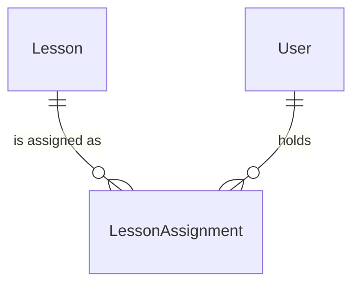

## Goal

A teacher gives lessons from their own courses to the students they teach, one lesson or a
whole unit at a time, and can take them back (withdraw). A student sees the lessons they hold
on `/curriculum`; a parent sees their children's, read-only. This is the roadmap's C2
"assign lessons" and `get_student_curriculum`. Completion, notifications and lesson
resources are later units (cur-lesson-completion, cur-assignment-notifications,
cur-lesson-resources) that build on the `LessonAssignment` rows added here.

What exists (backend `origin/main` 3cf6e75, dashboard `origin/main` a776875):

- `Course` / `Unit` / `Lesson` (migration `curriculum/0004`), owner-scoped services and the
  builder at `/curriculum` and `/curriculum/$courseId`, teachers only. Students get the
  "Coming soon" placeholder; parents have no Curriculum nav item.
- The teaching-link port `kaleem.platform.teaching` (`teaches`,
  `student_ids_taught_by`), registered by scheduling. `identity.services.is_parent_of`
  and `get_users`.
- The e2e seed: `e2e.teacher` owns "E2E Course" (`seed_e2e_curriculum`) and teaches
  `e2e.booked` (`seed_e2e_matching`); `e2e.guardian` is `e2e.booked`'s only parent.

**Decision basis.** dec-cur-terminology (resolved: *lesson* is curriculum, *session* is a
call). dec-cur-ownership (resolved 2026-10-18, option 1: courses are private to the teacher;
**students keep access after a teacher change**). **dec-cur-parent-visibility: OPEN.** This
spec is drafted on its recommended option, *read-only*; see Open questions.

## User flow

**Teacher**, in the builder (`/curriculum/$courseId`):

1. Every unit has **Assign** ("Assign Unit 1") and every lesson has **Assign** ("Assign
   Lesson A"). It opens a dialog listing the students the teacher currently teaches, by
   name, as checkboxes.
2. A student is checked when they hold every lesson in the target. A student who holds only
   some shows unchecked with "Has some of these lessons".
3. **Save** assigns the target's lessons to each newly checked student and withdraws them
   from each newly unchecked one. Students left as they were are not touched. The dialog
   closes and announces "Assignments saved".
4. No students yet: the dialog says so and offers nothing to save.
5. A lesson added to a unit later is not assigned automatically; the unit's dialog then shows
   "Has some of these lessons" for those students.
6. Deleting a course, unit or lesson also removes it from every student who holds it. The
   existing delete confirmations say so.

**Student**, on `/curriculum`: "Your lessons", grouped by course (title and subject), then
unit, in the teacher's order, showing only the lessons they hold. Each lesson opens in place
to show its text. Empty state: "No lessons yet. Your teacher assigns them here."

**Parent**, on `/curriculum` (new nav item for parents): the same view for a child, with a
"Lessons for" picker listing each linked child, and "Me" when the parent is also a student.
The picker is hidden when there is one choice. Nothing on the page can be changed. No
children and no student profile: "Link a child to see their lessons", linking to `/family`.

An account with several profiles sees the teacher's course list first, then the lessons
view.

**After a teacher change** (the teaching link ends): the student keeps every lesson they hold
and still sees it. The former teacher no longer lists that student and can neither assign
to nor withdraw from them. The teacher can still edit or delete the course, which changes
or removes what the student sees.

**Errors:**

- Not the course's owner, or no such course: 404, as today.
- A student the teacher does not currently teach, or no such account: 404 "Student not
  found.", the same either way.
- A lesson id that is not in this course (deleted in another tab, or foreign): 409 "The
  course changed. Reload and try again." Nothing is written. The dialog refetches.
- Empty lists, more than 100 lessons or more than 50 students in one request: 400.
- The lessons view for someone who is neither you nor your child: 404 "Student not found."

## Data model delta

Migration `curriculum/0005_lessonassignment` (the conductor renumbers at freshness).

- **LessonAssignment**: `lesson` → `Lesson` (CASCADE, `related_name="assignments"`),
  `student` → `AUTH_USER_MODEL` (by string, CASCADE, `related_name="lesson_assignments"`),
  `created_at`. `UniqueConstraint(lesson, student)`.
- The assigner is always the course's owner, so no `assigned_by` column. Withdrawal is a
  hard delete. Assigning again later makes a new row. Many rows over time, never a
  OneToOne (rule 7). No logic on the model (rule 4).

**ADR-0023:**

- **What:** which lessons a student holds and since when, linked to the student's user id.
  For a child account this is children's data.
- **Why:** it is what the student studies, and what completion builds on.
- **How long:** until the teacher withdraws it, the lesson, unit or course is deleted, or
  the student's account is erased. Erasing the teacher's account deletes their courses
  (`curriculum.courses`, unchanged), so their students lose those lessons too.
- **Who sees it:** the student; their linked parents, read-only; the owning teacher, only
  while they teach that student. Not in the Django admin (dec-admin-surface).

Registry (ADR-0048): a new `curriculum.lesson_assignments` hook pair. Export gives a
student their assignments as course, unit and lesson titles with the date assigned. Lesson
bodies are the teacher's text and are not included. Erase deletes the student's rows. The
teacher's export is unchanged. `curriculum` stays in `PENDING_ERASE` (the subject tables are
still uncovered). The comment on `erase_courses` that asks this unit to revisit it is
answered: the cascade stays, and the spec says so.

**Expand/contract:** one new table. The old colour never reads it, and the previous
dashboard bundle never calls the new endpoints. No column changes.

## API delta

All under `/api/v1/curriculum/` (ADR-0029), session auth and CSRF.

| Method | Path | Body | Result |
| --- | --- | --- | --- |
| GET | `courses/<id>/assignments/` | | roster |
| POST | `courses/<id>/assignments/` | `{lessons: [id], students: [id]}` | roster |
| POST | `courses/<id>/assignments/withdraw/` | `{lessons: [id], students: [id]}` | roster |
| GET | `students/<user id>/lessons/` | | lessons view |

- Roster: `{students: [{id, name}], assignments: [{lesson, student}]}`. `students` is the
  teacher's current students (the port's `student_ids_taught_by`, names from
  `identity.services.get_users`). `assignments` covers this course's lessons and only
  those students.
- Assign creates every missing (lesson, student) pair and skips pairs that exist. Withdraw
  deletes the pairs and ignores pairs that are absent. Both run in one transaction that
  locks the course row first (the builder's rule), so they serialize with edits and
  deletes.
- Lessons view: `{courses: [{id, title, subject: {slug, name}, units: [{id, title,
  lessons: [{id, title, body}]}]}]}`. Courses oldest first, units and lessons in position
  order, only units holding at least one of the student's lessons. No teaching-link check:
  that is option 1's "students keep access".
- Write refusals: no teacher profile 403; then as listed under Errors.

New services, by id per the module's convention: `list_course_assignments(teacher_id,
course_id)`, `assign_lessons(teacher_id, course_id, *, lesson_ids, student_ids)`,
`withdraw_lessons(...)` (same signature), and `get_student_curriculum(student_id)`. The
last one takes no actor: the view authorizes, being the student or `is_parent_of`.

## Frontend

- `/curriculum` (`CurriculumPage`): a teacher sees `CourseList` as today. A student or parent
  then sees `StudentLessons`, with a `LessonsForPicker` built from `/me` (`children[].id`
  are user ids, the same source `SchedulePage` uses). The placeholder leaves this page.
- `/curriculum/$courseId`: unchanged for teachers. Anyone else gets the builder's existing
  not-found state instead of "Coming soon".
- New components in `src/features/curriculum/components/`: `AssignDialog` (from `Dialog`,
  `Checkbox`, `SubmitButton`), `StudentLessons` and `LessonsForPicker`. `UnitSection` and
  `LessonRow` gain the Assign button. States: loading, empty, error with retry, success.
  Lessons use `
`/`
` with the body as pre-wrapped text, no HTML.
- Calls go through `curriculumApi` with hooks in `queries.ts`: `useCourseAssignments`,
  `useAssignLessons`, `useWithdrawLessons` and `useStudentLessons(studentId)`. A 404 or 409
  on save refetches the roster.
- Nav: Curriculum gains `parent` in `requiresAny`. Home drops `/curriculum` from the
  "Coming soon" set.
- Copy: new keys in the lazily loaded `curriculum` catalogue (`src/locales/{en,ar}/curriculum.json`),
  none in `common.json`. The three delete-confirmation bodies gain "Students it is assigned
  to lose it too." Arabic goes to hg-arabic-review.
- Tokens-only styles, logical properties, both themes, Arabic RTL, 320 px reflow, 44 px
  targets, WCAG 2.2 AA.

## Module boundaries

Owner: `curriculum`. It calls `kaleem.platform.teaching` (the ADR's port, first consumer),
`identity.services.get_users`, `get_teacher_profile`, `get_student_profile` and
`is_parent_of`, and `kaleem.platform` (exceptions, registry). All allowed today, so no
import-linter contract changes. No events. Notifications are cur-assignment-notifications'
job (dec-cur-notify-recipients).

Docs: `docs/architecture/curriculum.md` gains the model, the four services, the endpoints
and the visibility rule.

## Out of scope

- Completion and progress (cur-lesson-completion), notifications, lesson resources.
- Assigning a whole course in one action, due dates, assigning to a group.
- Staff views, and assigning another teacher's course (dec-cur-ownership option 1).
- Keeping lessons after the teacher deletes them or erases their account.
- Any change to the teaching port or to scheduling.

## Test plan

Backend (pytest, written first):

- Model: the pair is unique; deleting a lesson, unit or course removes its assignments.
- Services: assign creates the cross product and is idempotent; withdraw removes only the
  named pairs; a non-taught student is `NotFoundError` with nothing written; a lesson from
  another course is `ConflictError` with nothing written; another teacher's course is
  `NotFoundError`; the roster lists only current students; after the teaching link ends
  the student still gets the lesson from `get_student_curriculum` while the teacher can no
  longer list, assign or withdraw; `get_student_curriculum` orders and filters correctly
  and takes a constant number of queries.
- API: 403 without a teacher profile; CSRF enforced on both POSTs; 400 on empty or
  oversized lists; lessons view allowed for self and parent, 404 for anyone else with the
  same body as an unknown id; exact response keys.
- Registry: `assert_hooks_honour_contract("curriculum.lesson_assignments", ...)`; erasing
  one student leaves another's rows.
- Seed: re-running `seed_e2e_curriculum` leaves `e2e.booked` with no assignments.
- Arabic catalog entries for every new message.

Dashboard (vitest): the dialog's checked and "some" states; save sends exactly the diff;
409 refetches; empty-students state; the lessons view's states and order; the picker
hides with one option; a parent sees no control that writes; nav shows Curriculum to a
parent; Home's badge rule.

e2e (`e2e/curriculum-assignment.spec.ts`, serial, budget 40 s, accounts `teacher`,
`booked`, `guardian`; the seed gives a clean start):

1. The teacher assigns "Unit 1" to E2E Booked Student; after a reload the dialog shows the
   student checked. As `booked`, `/curriculum` lists Lesson A, B and C under Unit 1 after a
   reload, and Unit 2 is absent (positive and negative control).
2. As `guardian`, the same lessons show, and the page has no Assign or Save control.
3. The teacher withdraws Unit 1. As `booked`, after a reload, the lessons are gone and the
   empty state shows.

`/curriculum` as `guardian` joins the Arabic and reflow sweeps (`e2e/routes/curriculum.ts`).
The CLAUDE.md D3 table gains a `curriculum — assignment` row at ship.

## Open questions

- **dec-cur-parent-visibility (OPEN, blocks this spec):** what can parents see of assigned
  lessons? Read-only (recommended, drafted here) / full, including marking complete /
  nothing. "Nothing" removes the parent view, the nav change and e2e flow 2; "full" moves
  nothing here (there is nothing to complete yet) but binds cur-lesson-completion.
- For the owner's approval with the spec: teacher erasure and deletes cascade to students'
  lessons; a former teacher cannot withdraw; a lesson added later is not auto-assigned.
